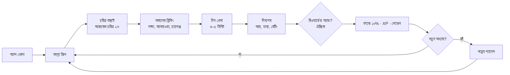

# ঢাকার একদিন: বিস্তারিত ডিজাইন (MVP)

**ভিত্তি:** `docs/GDD_v1.pdf` (Game Design Document, ২১ নভেম্বর ২০২৬)। GDD বলে *কী* বানানো হবে; এই ডকুমেন্ট বলে *ঠিক কীভাবে*, অর্থাৎ নিয়ম, সংখ্যা, স্ক্রিন, ডেটা আর কোডের গঠন। কোথাও GDD থেকে সরে গেলে বা নতুন সিদ্ধান্ত নিলে **[সিদ্ধান্ত]** লিখে চিহ্ন দেওয়া আছে। আপনার মত লাগবে এমন বিষয়গুলো শেষে **খোলা প্রশ্ন**-এ রাখা আছে।

**সংখ্যা নিয়ে:** এখানের সব সংখ্যা (দাম, গতি, সময়) শুরুর অনুমান। প্রোটোটাইপ খেলে ঠিক করা হবে। সব সংখ্যা কোডে নয়, `content/balance.json`-এ থাকবে (§১০), পরে Remote Config দিয়ে বদলানো যাবে।

---

## ১. MVP-র সীমানা

| থাকছে | থাকছে না (পরে) |
|---|---|
| ৩টা চরিত্র: রহিম চাচা (রিকশা), বাবু (বাস কন্ডাক্টর), মনির মামা (চা-দোকান) | বাকি ৬টা চরিত্র |
| **২টা এলাকা:** মিরপুর (শুরু), পুরান ঢাকা (মহল্লা লেভেল ৫-এ খোলে) **[সিদ্ধান্ত]** | ফার্মগেট, গুলশান, যাত্রাবাড়ী (লঞ্চের পরে, মাসে একটা) |
| বাবুর ১টা রুট: মিরপুর ১০ → মতিঝিল (আর ফেরত) | অন্য রুট |
| প্রতিটা চরিত্রের ৫টা গল্পের অধ্যায় (মোট ১৫) | ৬–৭ নম্বর অধ্যায় |
| কমিউনিটি ফান্ডের ৩টা প্রকল্প | বন্যার নৌকা (স্বেচ্ছাসেবক চরিত্রের সাথে) |
| আজকের চরিত্র, দৈনিক চ্যালেঞ্জ, ৭ দিনের টানা বোনাস | সিজন পাস |
| ইভেন্ট: বর্ষা আর শীত (দুটোই আবহাওয়া), পহেলা বৈশাখ | রমজান, ঈদ, বিজয় দিবস, ২১শে ফেব্রুয়ারি (ক্যালেন্ডার অনুযায়ী Remote Config-এ) |
| Rewarded ads, দিনশেষে interstitial, Remove Ads | কসমেটিক প্যাক, সিজন পাস |
| বাংলা + ইংরেজি | অন্য ভাষা |

**কেন ২টা এলাকা:** GDD-র ৫টা এলাকা মানে রিকশার জন্য ৫টা আলাদা ম্যাপ। MVP-তে ২টাই যথেষ্ট, যাতে "নতুন এলাকা খোলে" অনুভূতিটা থাকে কিন্তু কাজের চাপ কম থাকে।

---

## ২. ডিজাইনের মূল নীতি

1. **৩–৫ মিনিটে একটা পূর্ণ দিন।** প্রতিটা দিনের শুরু, চাপ আর শেষ আছে। দিন শেষে সবসময় কিছু একটা অগ্রগতি হয়: টাকা, তারা, গল্প বা মহল্লা।
2. **মানুষ নয়, পরিস্থিতি নিয়ে হাসি।** রিকশাওয়ালা, কন্ডাক্টর, দোকানির কাজ কঠিন, কিন্তু তাঁরা দক্ষ আর মর্যাদাবান। হাসি আসবে জ্যাম, বৃষ্টি, দরদাম আর অদ্ভুত যাত্রী থেকে।
3. **একজনের কাজ অন্যজনের দিন বদলায়।** প্রতিটা সিস্টেম অন্তত একটা চরিত্রের সাথে আরেকটার যোগ তৈরি করে (§৬)।
4. **শাস্তি নয়, দ্বিতীয় সুযোগ।** খারাপ দিনেও কিছু আয় হয়। টানা খেলা না হলে কিছু হারায় না, শুধু বোনাস মেলে না।
5. **পুরো গেম অফলাইনে চলে।** ইন্টারনেট লাগে শুধু ads, কেনাকাটা আর ঐচ্ছিক আপডেটের জন্য।

---

## ৩. সেশন ও স্ক্রিন প্রবাহ



### স্ক্রিনের তালিকা

| স্ক্রিন | কী থাকে |
|---|---|
| **স্প্ল্যাশ / প্রথম খোলা** | লোগো; প্রথমবার ভাষা বাছাই (বাংলা আগে থেকে বাছা) |
| **মহল্লা (হোম)** | মহল্লার একটা ইলাস্ট্রেশন, যা আপগ্রেড আর প্রকল্পে বদলায় (বাতি জ্বলে, দোকান বড় হয়)। ওপরে টাকা, তারা আর মহল্লা লেভেল। ৩টা চরিত্রের কার্ড, "আজকের চরিত্র"-এ ২× ব্যাজ। নিচে দৈনিক চ্যালেঞ্জ, টানা খেলার দিন, ফান্ড প্রকল্পের অগ্রগতি |
| **চরিত্রের পাতা** | পোর্ট্রেট, গল্পের অগ্রগতি (৩/৫), আপগ্রেড দোকান, "দিন শুরু" বোতাম |
| **সকালের ব্রিফিং** | এক লাইনের মুহূর্ত ("আজ বৃষ্টি হতে পারে, চাচা।"), আজকের লক্ষ্য (৳৬০০), চ্যালেঞ্জ, আবহাওয়া আইকন |
| **দিন খেলা** | চরিত্রের নিজস্ব মিনি-গেম (§৪), ওপরে সময়ের ঘড়ি আর আজকের আয় |
| **দিনশেষ** | আয়ের হিসাব (আয় − খরচ − ফান্ডে ১০%), রেটিং, তারা, XP বার। "অ্যাড দেখে আয় দ্বিগুণ" বোতাম |
| **গল্পের প্যানেল** | ২–৪টা ছবি, প্রতিটার নিচে সংলাপ (ভিজ্যুয়াল নভেল ধাঁচ), ট্যাপ করে এগোনো |
| **কমিউনিটি ফান্ড** | ৩টা প্রকল্প, প্রতিটার দাম, অগ্রগতি আর সুবিধা; খেলোয়াড় একটা বেছে নেন, ফান্ড সেটায় যায় |
| **সেটিংস** | ভাষা, শব্দ, মিউজিক, কম্পন, Remove Ads কেনা, কেনাকাটা ফিরিয়ে আনা, গোপনীয়তা নীতি |

**প্রথমবার খেলা:** অ্যাপ খুললে সরাসরি রহিম চাচার একটা ছোট, গাইড করা দিন শুরু হয় (৯০ সেকেন্ড, ২টা যাত্রী, কোনো ব্যর্থতা নেই)। মহল্লা স্ক্রিন আসে তার পরে। প্রথম ৩০ সেকেন্ডেই খেলা শুরু।

---

## ৪. চরিত্রগুলোর বিস্তারিত

সব চরিত্রে কিছু জিনিস এক:
- **খেলার ঘড়ি:** দিনের কয়েক ঘণ্টা ৪ মিনিট বাস্তব সময়ে চলে।
- **দিনশেষের ফল:** একই `DayResult` গঠনে আসে (§৯)।
- **শুরুর পাঠ:** প্রথম দিনটা গাইড করা।

### ৪.১ রহিম চাচা: রিকশাওয়ালা (নেভিগেশন)

**লক্ষ্য:** দিনে কমপক্ষে ৳৬০০ আয়। বাড়তি টাকা জমে মেয়ের স্কুল ফি-র তহবিলে, যা গল্প এগিয়ে নেয়।

**ঘড়ি:** সকাল ৭টা থেকে রাত ৯টা, ৪ মিনিটে। খেলায় ১ ঘণ্টা ≈ ১৭ সেকেন্ড। এনার্জি শূন্য হলে আগেই দিন শেষ ("চাচা ক্লান্ত, বাড়ি ফিরলেন")।

**ম্যাপ:**
- ওপর থেকে দেখা টাইল ম্যাপ, মিরপুর ২০×২৮ টাইল।
- রাস্তা দুই ধরনের: বড় রাস্তা (দুই দিকে চলে) আর গলি (কিছু একমুখী, তীর চিহ্ন দেওয়া)।
- চিহ্নিত জায়গা: চায়ের দোকান (এনার্জি ফেরে), যাত্রী দাঁড়ানোর জায়গা, ট্রাফিক পুলিশের জায়গা।
- ম্যাপ [Tiled](https://www.mapeditor.org) দিয়ে আঁকা হবে, `.tmx` ফাইল। Flame সরাসরি পড়তে পারে।

**নিয়ন্ত্রণ [সিদ্ধান্ত]:**
- রিকশা রাস্তা ধরে নিজে চলে।
- মোড়ে আসার আগে সোয়াইপ করে দিক ঠিক করতে হয় (বাঁয়ে, ডানে, সোজা, ফেরা)।
- ওপরে একটা ছোট তীর গন্তব্যের দিক দেখায়।
- এতে এক হাতে খেলা যায় আর আসল চ্যালেঞ্জ থাকে "কোন রাস্তা নেব"-তে।

**যাত্রী আর দরদাম:**
- ম্যাপে একসাথে ৩–৫ জন যাত্রী অপেক্ষা করেন। প্রত্যেকের মাথায় গন্তব্য আর প্রস্তাবিত ভাড়া দেখা যায়।
- কাছে গেলে দরদামের ৩টা বোতাম আসে:

| বোতাম | কী হয় |
|---|---|
| **রাজি** | প্রস্তাবিত ভাড়ায় যাত্রী ওঠেন |
| **পাল্টা অফার** (ন্যায্য ভাড়ার ১.২ গুণ) | যাত্রীর ধরন অনুযায়ী রাজি হওয়ার সম্ভাবনা; না হলে চলে যান |
| **মানা** | যাত্রী থেকে যান, রহিম চাচা এগিয়ে যান |

- **ন্যায্য ভাড়া:** ৳২০ + প্রতি টাইল ৳৬, সবচেয়ে ছোট পথে। ৫-এর গুণিতকে গোল করা হয়।
- **যাত্রীর ধরন:**

| ধরন | প্রস্তাব (ন্যায্য ভাড়ার গুণ) | পাল্টা অফারে রাজি হওয়ার সম্ভাবনা |
|---|---|---|
| সাধারণ | ০.৯–১.০ | ৬০% |
| কৃপণ | ০.৬–০.৮ | ৩০% |
| তাড়াহুড়ো (অফিসগামী) | ১.০–১.১ | ৯০% |
| বয়স্ক / মা-শিশু | ০.৮–০.৯ | ৫০%; রাজি হলে রেটিং বেশি |

- **বৃষ্টিতে:** সব যাত্রীর পাল্টা অফারে রাজি হওয়ার সম্ভাবনা আরও ২০% বেশি।

**বাধা:**

| বাধা | প্রভাব |
|---|---|
| জলাবদ্ধ টাইল | গতি অর্ধেক; যাত্রী থাকলে ঝাঁকুনিতে রেটিং −০.৫ তারা |
| একমুখী রাস্তায় উল্টো দিকে ঢোকা | পুলিশ থামায়: ৳৫০ জরিমানা আর ৫ সেকেন্ড দাঁড়িয়ে থাকা |
| ট্রাফিক পুলিশের মোড় (লাল বাতি) | ৩ সেকেন্ড অপেক্ষা; না থামলে জরিমানা |
| হঠাৎ বৃষ্টি (দিনে ০–১ বার, ৪০ সেকেন্ড) | জলাবদ্ধ টাইল দ্বিগুণ, এনার্জি খরচ বাড়ে, কিন্তু যাত্রী বেশি দেন |

**এনার্জি:**
- এনার্জি ১০০ থেকে শুরু। প্রতি টাইলে −০.৫, বৃষ্টিতে −০.৮।
- ২০-এর নিচে নামলে গতি ৭০%।
- চায়ের দোকানে থামলে ৳২০ খরচে +৪০ এনার্জি। এই কেনা মনির মামার "নিয়মিত কাস্টমার" হিসাবে গোনা হয় (§৬)।

**রেটিং (যাত্রীপ্রতি ১–৫ তারা):**
- শুরু ৫ তারা থেকে।
- প্রত্যাশিত সময়ের (পথের দৈর্ঘ্য ÷ গতি × ১.৩) পরে প্রতি ১০% দেরিতে −১ তারা।
- প্রতিটা জলাবদ্ধ টাইলে −০.৫ তারা।
- ৫ তারা পেলে যাত্রী ৳১০ বখশিশ দেন।

**দিনশেষে আয়:** ভাড়া + বখশিশ − জরিমানা − চা।

**গতি:** ২.৫ টাইল/সেকেন্ড। আপগ্রেড: নতুন রিকশা ×১.১৫; ব্যাটারি রিকশা ×১.৫, সাথে এনার্জি খরচ অর্ধেক।

### ৪.২ বাবু: লোকাল বাস কন্ডাক্টর (টাইম-ম্যানেজমেন্ট)

**লক্ষ্য:** একটা ট্রিপে সর্বোচ্চ ভাড়া তোলা, কেউ যেন ভাড়া না দিয়ে নামতে না পারে।

**দিনের গঠন:** ২টা ট্রিপ, প্রতিটা প্রায় ২ মিনিট।
- সকালে: মিরপুর ১০ → মতিঝিল
- বিকেলে: মতিঝিল → মিরপুর ১০

**রুট (৯টা স্টপ):** মিরপুর ১০ · কাজীপাড়া · শেওড়াপাড়া · আগারগাঁও · ফার্মগেট · কারওয়ান বাজার · শাহবাগ · প্রেস ক্লাব · মতিঝিল। স্টপের মাঝে ১২–১৫ সেকেন্ড চলে।

**দৃশ্য:** বাসের ভেতর পাশ থেকে দেখা। বাঁদিকে দরজা, সামনে মহিলা আর বয়স্কদের সিট। ওপরে রুটের দাগ, যাতে বাসের অবস্থান দেখা যায়।

**ডাক মিনি-গেম (স্টপে পৌঁছানোর ২ সেকেন্ড আগে):**
- একটা টাইমিং বার এদিক-ওদিক চলে। ট্যাপ করলে বাবু স্টপের নাম ডাকেন ("ফার্মগেট! ফার্মগেট!")।
- নিখুঁত সময়ে ট্যাপ: +২ যাত্রী; ভালো: +১; ফসকালে: বাড়তি যাত্রী নেই।
- ডাকের শব্দ আসল কণ্ঠে রেকর্ড করা হবে।

**ভাড়া তোলা:**
- নতুন যাত্রীর মাথায় 💰 চিহ্ন থাকে। ট্যাপ করলে নিচে একটা প্যানেল খোলে: "শাহবাগ পর্যন্ত, ৳২০ ভাড়া; দিলেন ৳১০০"।
- ভাড়া: ৳১০ সর্বনিম্ন, প্রতি স্টপে +৳৫, সর্বোচ্চ ৳৩৫।
- **ভাংতি:** খেলোয়াড় হাতের ব্যাগ থেকে নোট টেনে ফেরত দেন।
  - দিনের শুরুতে ব্যাগে ৳২০০ ভাংতি থাকে।
  - যাত্রীর কাছ থেকে নেওয়া ছোট নোট ব্যাগে যোগ হয়।
  - ঠিক ফেরত দিলে রেটিং ভালো থাকে। কম দিলে তর্ক হয় (৩ সেকেন্ড আটকে থাকা, রেটিং কমে)। বেশি দিলে নিজের টাকা যায়।
  - ব্যাগে ভাংতি শেষ হলে "ভাংতি নেই" ঘটনা আসে: যাত্রী বিরক্ত, ২টা বিকল্প:
    - "পরে দেব": রেটিং কমে, যাত্রী নামার সময় দিতে হয়
    - "অন্য যাত্রীর থেকে ভাংতি নিন": সময় লাগে

**সিট সামলানো:**
- ২৪টা সিট (৪টা মহিলা, ২টা বয়স্ক) আর ১০ জন দাঁড়িয়ে থাকার জায়গা।
- বয়স্ক যাত্রী উঠলে কাউকে উঠিয়ে সিট দিতে হয় (ট্যাপ করে)।
- মহিলা সিটে পুরুষ বসলে ট্যাপ করে সরাতে হয়।
- ৩০ জনের বেশি হলে "ভিড়": প্রতি সেকেন্ডে রেটিং একটু কমে।

**ফাঁকিবাজ:**
- ~৮% যাত্রী নিজের স্টপে ভাড়া না দিয়ে নামার চেষ্টা করেন। দরজার দিকে গেলে হালকা জ্বলে ওঠেন।
- দরজা বন্ধ হওয়ার আগে ট্যাপ করলে ভাড়া আদায় হয়।

**চেকিং:**
- ট্রিপে ০–১ বার কোনো স্টপে চেকার ওঠেন।
- তখন বাসে কেউ ভাড়া না দিয়ে থাকলে প্রতিজনে ৳২০ জরিমানা।

**ছাত্র যাত্রী:** অর্ধেক ভাড়া দেন। রাজি হলে রেটিং বাড়ে, আয় কমে। এটা খেলোয়াড়ের নিজের সিদ্ধান্ত।

**সময়মতো পৌঁছানোর বোনাস:**
- স্টপে বেশি সময় লাগলে বাস দেরি করে।
- ট্রিপ লক্ষ্য সময়ের মধ্যে শেষ হলে +৳৫০।

**স্কোর:** তোলা ভাড়া − ফাঁকি − জরিমানা − ভুল ভাংতি + সময়ের বোনাস।

### ৪.৩ মনির মামা: চা-দোকানি (টাইকুন)

**লক্ষ্য:** দিনের কাস্টমার সামলানো আর দোকান বড় করা: টং → দোকান → ছোট ক্যাফে।

**ঘড়ি:** ভোর ৬টা থেকে রাত ১১টা, ৪ মিনিটে।
- ভিড়ের সময়: সকাল ৭–৯টা আর সন্ধ্যা ৫–৮টা, তখন দ্বিগুণ কাস্টমার।

**দৃশ্য:** সামনে থেকে দেখা দোকান। কাউন্টারে কেটলি, কাপ, দুধ, চিনি, কলার কাঁদি, বনরুটির বয়াম আর পানের বাটা। সামনে বেঞ্চে কাস্টমার।

**অর্ডার:**
- কাস্টমার এলে মাথার বুদবুদে ১–২টা আইটেম দেখায়।
- প্রতিটা আইটেম বানাতে উপকরণ ঠিক ক্রমে ট্যাপ করতে হয়:

| আইটেম | ধাপ | দাম |
|---|---|---|
| লিকার চা | কাপ → কেটলি | ৳১০ |
| দুধ চা | কাপ → কেটলি → দুধ → চিনি | ৳১৫ |
| কলা | কাঁদি | ৳১০ |
| বনরুটি | বয়াম | ৳২০ |
| পান | পাতা → সুপারি → চুন | ৳১০ |

**ধৈর্য বার:**
- স্বাভাবিক সময় ১২ সেকেন্ড। অফিসগামীর ৮ সেকেন্ড, বয়স্কের ১৬ সেকেন্ড।
- বার শেষ হলে কাস্টমার চলে যান। ভুল ক্রমে বানালে আবার করতে হয়।

**কেটলি:** একবারে ৮ কাপ চা হয়। শেষ হলে ৫ সেকেন্ড ধরে আবার ভরতে হয়। দ্বিতীয় কেটলি কিনলে একটা ভরার সময় অন্যটা চলে।

**কাস্টমার আসার হার:** গড়ে প্রতি ৬ সেকেন্ডে একজন, ভিড়ের সময় প্রতি ৩ সেকেন্ডে।

**নিয়মিত কাস্টমার:**
- রহিম চাচা আর বাবু দিনে একবার করে আসেন। তাঁদের অর্ডার ঠিক সময়ে দিলে গল্পের ইঙ্গিত দেন ("কাল একটা ভালো যাত্রী পেয়েছিলাম…")।
- নামধারী NPC-রাও আসেন (§৬)।

**দোকানের আপগ্রেড (দুই দিনের মাঝে কেনা হয়):**

| আপগ্রেড | দাম | প্রভাব |
|---|---|---|
| বেঞ্চ | ৳৮০০ | কাস্টমার +২০%, বসা কাস্টমারের ধৈর্য +৩ সেকেন্ড |
| দ্বিতীয় কেটলি | ৳১,২০০ | ভরার সময়েও চা চলে |
| ছাউনি | ৳১,৫০০ | বৃষ্টিতেও কাস্টমার কমে না (এমনিতে ৫০% কমে) |
| ফ্রিজ | ৳৩,০০০ | নতুন আইটেম ঠান্ডা পানীয় (৳২৫), গরমের দিনে বেশি বিক্রি |
| দোকান (টং → দোকান) | ৳৫,০০০ + অধ্যায় ৩ | নতুন দৃশ্য, কাউন্টারে ২ জন কাজ করেন |

**স্কোর:** বিক্রি + খুশি কাস্টমারের সংখ্যা। কাস্টমার যত দ্রুত পান, তত খুশি; খুশি কাস্টমারের ১০% বখশিশ দেন।

---

## ৫. অর্থনীতি ও অগ্রগতি

### ৫.১ মুদ্রা

| মুদ্রা | কোথা থেকে | কোথায় খরচ |
|---|---|---|
| **টাকা (৳)** | প্রতিটা দিন খেলে (গড়ে ৳৪৫০–৮০০) | চরিত্রের আপগ্রেড |
| **তারা (⭐)** | দৈনিক চ্যালেঞ্জ (+৩), টানা খেলা (+৫ থেকে +২০), অধ্যায় শেষ (+৫), rewarded ad (+২), কেনা | আরেকবার চেষ্টা (৫), চরিত্র আগে আনলক (৩০), কসমেটিক (১০–৪০) |
| **কমিউনিটি ফান্ড** | সব আয়ের ১০%, নিজে থেকে কাটা যায় | মহল্লার প্রকল্প (§৫.৩) |

### ৫.২ মহল্লা লেভেল (১–৫০)

- **XP:** প্রতিটা দিনে XP = ৫০ + (দিনের রেটিং × ২০) + গল্পের অধ্যায় শেষ হলে ১০০। গড়ে দিনে ১০০–১৫০ XP।
- **পরের লেভেলে যেতে লাগে:** ৮০ + ৪০ × বর্তমান লেভেল। লেভেল ৫-এ পৌঁছাতে ~৫ দিন, লেভেল ২০-এ ~৫০ দিন।
- **লেভেলে যা খোলে:**

| লেভেল | যা খোলে |
|---|---|
| ১ | রহিম চাচা, মিরপুর |
| ২ | মনির মামা |
| ৪ | বাবু |
| ৫ | পুরান ঢাকা (রহিম চাচার দ্বিতীয় ম্যাপ) |
| ৮, ১২, ১৬… | প্রতি ৪ লেভেলে নতুন চরিত্র (লঞ্চের পরের আপডেট) |

চরিত্র আগে খুলতে চাইলে ৩০ তারা দিয়ে খোলা যায়।

### ৫.৩ কমিউনিটি ফান্ডের প্রকল্প

খেলোয়াড় একটা প্রকল্প বেছে নেন। ফান্ডের টাকা সেটায় জমা হয়, দাম পূর্ণ হলে মহল্লার ছবি বদলায় আর স্থায়ী সুবিধা আসে।

| প্রকল্প | দাম | সুবিধা |
|---|---|---|
| রাস্তার বাতি | ৳২,০০০ | সন্ধ্যায় চা-দোকানে কাস্টমার +১৫%; রাতে রিকশায় বেশি যাত্রী |
| নর্দমা পরিষ্কার | ৳৩,০০০ | মিরপুরে জলাবদ্ধ টাইল অর্ধেক |
| যাত্রী ছাউনি | ৳২,৫০০ | বাসস্টপে বৃষ্টিতেও যাত্রী কমে না |

তিনটা শেষ হলে লঞ্চের পরের আপডেটে নতুন প্রকল্প আসবে।

### ৫.৪ চরিত্রের আপগ্রেড

| চরিত্র | ধাপ ১ | ধাপ ২ | ধাপ ৩ |
|---|---|---|---|
| রহিম চাচা | নতুন রিকশা ৳১,৫০০ (গতি ×১.১৫) | ব্যাটারি রিকশা ৳৬,০০০ (গতি ×১.৫, এনার্জি খরচ অর্ধেক) | রিকশা আর্ট (কসমেটিক, তারা দিয়ে) |
| বাবু | ছোট খাতা ৳৮০০ (কে ভাড়া দেননি, তালিকায় দেখা যায়) | ভাংতির ব্যাগ ৳১,৮০০ (শুরুতে ৳৪০০ ভাংতি, নোট টানা দ্রুত) | গলার জোর ৳২,৫০০ (ডাকের নিখুঁত অংশ বড়) |
| মনির মামা | §৪.৩-এর টেবিল | | |

---

## ৬. চরিত্রদের মধ্যে সংযোগ

### ৬.১ ফিরে আসা মানুষ (নামধারী NPC)

- ২০ জন নামধারী মানুষ আছেন, যেমন রুমানা আপা (স্কুল শিক্ষিকা), কামাল ভাই (অফিসের কেরানি), ফারহান (কলেজ ছাত্র)।
- প্রত্যেকের একটা **সম্পর্ক** মান আছে, −৫ থেকে +৫।
- এক চরিত্রের দিনে এঁদের সাথে কেমন ব্যবহার হলো, তা অন্য চরিত্রের দিনে ফল আনে:

| কী হলো | পরে কী হয় |
|---|---|
| রহিম চাচা ৫ তারায় পৌঁছে দিলেন | সেই NPC পরে চা-দোকানে আসেন, ৳২০ বখশিশ দেন আর এক লাইন বলেন ("চাচা কাল দারুণ চালিয়েছেন!") |
| বাবু ছাত্রকে অর্ধেক ভাড়ায় নিলেন | ফারহান পরে রহিম চাচার যাত্রী হয়ে বেশি ভাড়া দেন |
| কাউকে খারাপ ব্যবহার (পাল্টা অফারে রাজি না হলে বা দেরিতে চা) | তিনি অভিযোগ করেন; মহল্লার মেজাজ একটু কমে, যা দৈনিক চ্যালেঞ্জ কঠিন করে |

- এই সব ঘটনা একটা "মহল্লার ঘটনার খাতা"-য় জমা হয় (§৯.৩)। পরের দিনগুলো সেখান থেকে বেছে নিয়ে দেখায়।

### ৬.২ গল্পের অধ্যায় (MVP-তে প্রতিজনের ৫টা)

অধ্যায় খোলে টাকা জমানো আর দিনের সংখ্যা মিলিয়ে, যাতে শুধু অনেক খেললেই নয়, ভালো খেললেও খোলে।

| চরিত্র | অধ্যায় ও কখন খোলে (মোটামুটি) |
|---|---|
| **রহিম চাচা** | ১. শহরে প্রথম দিন (গাইড করা দিন) · ২. মেয়ে সুমির ভর্তির খবর (৩ দিন) · ৩. বৃষ্টির রাতে এক অসুস্থ যাত্রী (মোট ৳৩,০০০) · ৪. নতুন রিকশা (আপগ্রেড কিনলে) · ৫. সুমির ভর্তি (মোট ৳৮,০০০ জমা) |
| **বাবু** | ১. প্রথম রুট · ২. ড্রাইভার ওস্তাদের সাথে ঝগড়া · ৩. হারানো মানিব্যাগ (সৎ থাকার সিদ্ধান্ত) · ৪. বাড়িতে টাকা পাঠানো · ৫. নিজের বাসের স্বপ্ন |
| **মনির মামা** | ১. টং খোলা · ২. প্রথম নিয়মিত কাস্টমার · ৩. টং থেকে দোকান (আপগ্রেড) · ৪. বৃষ্টিতে পুরো মহল্লা দোকানে · ৫. ছোট ক্যাফের পরিকল্পনা |

প্রতিটা অধ্যায় ২–৪টা ছবির প্যানেল আর ৬–১২ লাইন সংলাপ। সব লেখা `content/story/*.json`-এ থাকবে, বাংলা ও ইংরেজিতে।

---

## ৭. দৈনিক কাঠামো ও ইভেন্ট

- **আজকের চরিত্র:**
  - তারিখ থেকে হিসাব করা হয় (খোলা চরিত্রগুলো ক্রমে ঘোরে), তাই সার্ভার লাগে না।
  - সেই চরিত্রে প্রথম দিনে ২× আয় পাওয়া যায়।
  - অন্য চরিত্রও যতবার খুশি খেলা যায়।
- **দৈনিক চ্যালেঞ্জ:** টেমপ্লেট থেকে তারিখ ধরে বাছাই। ৩টা উদাহরণ:
  - "১০ জন যাত্রীকে ৩ তারার বেশি সার্ভিস দাও"
  - "কোনো ফাঁকিবাজ যেন না নামে"
  - "সকালের ভিড়ে ২০টা চা"
- **টানা খেলার বোনাস:**

| দিন | পুরস্কার |
|---|---|
| ১ | +৫ তারা |
| ২ | +৫ তারা |
| ৩ | +১০ তারা |
| ৪ | +১০ তারা |
| ৫ | +১০ তারা |
| ৬ | +১৫ তারা |
| ৭ | বিশেষ জিনিস (রিকশার নকশা, ঈদের পোশাক ইত্যাদি) |

  এক দিন বাদ পড়লে গুনতি আবার ১ থেকে শুরু হয়, কিন্তু আগে পাওয়া পুরস্কার থেকে যায়।
- **আবহাওয়া:**
  - প্রতিটা দিনে আবহাওয়া এলোমেলোভাবে বাছা হয়, সম্ভাবনা মাস অনুযায়ী।
  - জুন–সেপ্টেম্বর: ৪০% বৃষ্টি। ডিসেম্বর–জানুয়ারি: ৩০% কুয়াশা, তাতে রিকশার ম্যাপে দূরের রাস্তা কম দেখা যায়।
- **ক্যালেন্ডারের ইভেন্ট:**
  - প্রতিটা ইভেন্ট `content/events.json`-এ একটা তারিখের পরিসর আর পরিবর্তনের তালিকা।
  - রমজান আর ঈদের তারিখ চাঁদ দেখার ওপর নির্ভর করে, তাই কোডে হিসাব না করে Remote Config থেকে আসবে।
  - GDD অনুযায়ী রাজনৈতিক ইভেন্ট (হরতাল, মিছিল) থাকবে না।

---

## ৮. আয়ের মডেল (বিস্তারিত নিয়ম)

| ধরন | কখন | নিয়ম |
|---|---|---|
| **Rewarded: আয় দ্বিগুণ** | দিনশেষের স্ক্রিনে | দিনে সর্বোচ্চ ৩ বার |
| **Rewarded: আরেকবার চেষ্টা** | দিনটা খারাপ গেলে, তারার বদলে | দিনে ২ বার |
| **Rewarded: +২ তারা** | মহল্লা স্ক্রিনে একটা বাক্স | দিনে ৩ বার |
| **Interstitial** | দিনশেষের স্ক্রিন বন্ধ করার পর | প্রতি তৃতীয় দিনশেষে, দিনে সর্বোচ্চ ৩টা; প্রথম ৩ দিনে একটাও নয়; খেলার মাঝখানে কখনো নয় |
| **Remove Ads** | সেটিংস আর দিনশেষের স্ক্রিন | ~৳১২০, interstitial বন্ধ (rewarded থাকে, খেলোয়াড় নিজে চাইলে) |
| **তারার প্যাক** | দোকান | ছোট প্যাক; শুধু সময় বাঁচায়, এমন কোনো জিনিস কেনা যায় না যা খেলায় সুবিধা দেয় |

- **বয়সের দিক:** লক্ষ্য খেলোয়াড় ১৪+ বছর। Google Play-তে টার্গেট অডিয়েন্স "১৩+" দিলে Families নীতি লাগে না।
- **Ads-এর ধরন:** AdMob-এ ads "Teen" মানের রাখতে হবে।
- **পেমেন্ট:** বাংলাদেশে Google Play-র কেনাকাটায় কোন পেমেন্ট পদ্ধতি চলে, লঞ্চের আগে যাচাই করতে হবে (GDD-র কথা অনুযায়ী)।

---

## ৯. কারিগরি ডিজাইন

### ৯.১ স্ট্যাক

| অংশ | পছন্দ | মন্তব্য |
|---|---|---|
| ইঞ্জিন | Flutter + **Flame** | মেনু আর ফর্ম Flutter widget-এ, মিনি-গেম Flame-এ |
| ম্যাপ | Tiled + `flame_tiled` | রিকশার ম্যাপ |
| সেভ | একটা JSON ফাইল (`path_provider`), atomic write **[সিদ্ধান্ত]** | GDD-তে Hive আছে, কিন্তু মূল Hive প্যাকেজ আর রক্ষণাবেক্ষণ হচ্ছে না; একটা ছোট JSON সেভই যথেষ্ট আর সহজ |
| সেটিংস | `shared_preferences` | ভাষা, শব্দ |
| অডিও | `flame_audio` | OGG ফাইল |
| Ads | `google_mobile_ads` | |
| কেনাকাটা | `in_app_purchase` | |
| Analytics, Crash, Remote Config | Firebase (ফ্রি) | Learning-App-এর মতো, Firebase না থাকলে কাজ না করে চুপ থাকে |
| ভাষা | Flutter `gen-l10n` (ARB) + content JSON-এ `{bn, en}` | |

### ৯.২ কোডের গঠন

```
app/lib/
  main.dart, app.dart
  core/            # থিম, ফন্ট, রাউটার, Remote Config, analytics
  economy/         # টাকা, তারা, ফান্ড, XP, লেভেল (পিওর ডার্ট, টেস্টসহ)
  world/           # মহল্লা, NPC খাতা, আজকের চরিত্র, চ্যালেঞ্জ, আবহাওয়া, ইভেন্ট
  story/           # অধ্যায়ের শর্ত আর প্যানেল প্লেয়ার
  save/            # SaveGame মডেল, লোড/সেভ, মাইগ্রেশন
  services/        # ads, purchases, analytics (Firebase ছাড়াও চলে)
  ui/              # মহল্লা, চরিত্রের পাতা, ব্রিফিং, দিনশেষ, সেটিংস
  characters/
    character_day.dart        # সবার জন্য এক interface
    rickshaw/                 # রহিম চাচা: game, components, rules
    bus/                      # বাবু
    tea_stall/                # মনির মামা
content/                      # JSON: balance, passengers, npcs, story, events, challenges
assets/                       # ছবি (atlas), Tiled ম্যাপ, শব্দ, ফন্ট
```

### ৯.৩ চরিত্রের interface

প্রতিটা চরিত্র একই চুক্তি মানে। নতুন চরিত্র মানে নতুন ফোল্ডার, বাকি গেম বদলায় না।

```dart
/// What the shared game gives a character for one day.
class DayContext {
  final DateTime date;
  final Weather weather;            // clear, rain, fog
  final List<ActiveEvent> events;   // e.g. pohela_boishakh
  final Upgrades upgrades;          // what this character owns
  final CommunityPerks perks;       // finished fund projects
  final List<NpcVisit> visitors;    // named NPCs due to appear today
  final Challenge? challenge;
  final bool featured;              // today's character: 2x income
  final Random rng;                 // seeded per day, so a retry is the same day
}

/// What a character's day hands back.
class DayResult {
  final int earned;                 // before the 10% fund
  final int spent;                  // fines, tea, wrong change
  final double rating;              // 1–5
  final List<NpcOutcome> npcOutcomes;
  final Map<String, num> stats;     // for challenges and analytics
  final bool challengeMet;
}

abstract class CharacterDay {
  String get id;                    // 'rickshaw', 'bus', 'tea_stall'
  FlameGame createGame(DayContext ctx, void Function(DayResult) onDayEnd);
  Widget? briefing(DayContext ctx); // optional custom morning screen
}
```

### ৯.৪ সেভের গঠন (`save.json`)

```json
{
  "schema": 1,
  "taka": 2350, "tara": 41, "fund": 640,
  "fundProject": "street_lights",
  "mohalla": {"level": 6, "xp": 210, "projectsDone": ["drain_cleaning"]},
  "characters": {
    "rickshaw": {"unlocked": true, "days": 14, "saved": 4200,
                 "upgrades": ["new_rickshaw"], "chapter": 3},
    "bus": {"unlocked": true, "days": 3, "upgrades": [], "chapter": 1},
    "tea_stall": {"unlocked": true, "days": 9, "upgrades": ["bench", "kettle2"], "chapter": 2}
  },
  "npcs": {"rumana": 3, "kamal": -1},
  "pendingVisits": [{"npc": "rumana", "at": "tea_stall", "kind": "thanks"}],
  "streak": {"count": 4, "lastDay": "2026-12-03"},
  "daily": {"date": "2026-12-03", "featuredPlayed": false, "adsDoubled": 1},
  "purchases": {"remove_ads": false},
  "settings": {"lang": "bn"}
}
```

- প্রতিটা দিন শেষ হলেই সেভ হয়। আগে নতুন ফাইলে লেখা হয়, তারপর নাম বদলে আগেরটার জায়গায় বসে, যাতে মাঝপথে বন্ধ হলেও সেভ নষ্ট না হয়।
- `schema` নম্বর দিয়ে পরের সংস্করণে পুরোনো সেভ আপডেট করা হয়।

### ৯.৫ Content (কোড না ছুঁয়ে বদলানো যায়)

| ফাইল | কী থাকে |
|---|---|
| `balance.json` | সব সংখ্যা: গতি, ভাড়া, ধৈর্য, দাম, XP, অ্যাডের সীমা |
| `passengers.json` | যাত্রীর ধরন, প্রস্তাবের গুণ, রাজি হওয়ার সম্ভাবনা, সংলাপ |
| `npcs.json` | ২০ জন নামধারী মানুষ, তাঁদের সংলাপ আর পুরস্কার |
| `story/*.json` | অধ্যায়: শর্ত, প্যানেলের ছবি, সংলাপ `{bn, en}` |
| `challenges.json` | দৈনিক চ্যালেঞ্জের টেমপ্লেট |
| `events.json` | ইভেন্টের তারিখ আর পরিবর্তন |
| `tea_menu.json`, `bus_route.json` | রেসিপি, স্টপ আর ভাড়া |

একটা যাচাই স্ক্রিপ্ট (`tool/validate_content.py`) CI-তে সব ফাইল পরীক্ষা করবে: দুই ভাষা আছে কি না, আইডি মেলে কি না, সংখ্যা সীমার মধ্যে কি না।

### ৯.৬ Analytics ইভেন্ট

| ইভেন্ট | প্যারামিটার |
|---|---|
| `day_start` | character, area, weather, featured |
| `day_end` | character, earned, rating, duration_s, quit_early |
| `bargain` | type (accept/counter/refuse), passenger_type, success |
| `chapter_unlock` | character, chapter |
| `upgrade_buy` | character, item, taka |
| `fund_project_done` | project |
| `ad_reward` | placement (double/retry/tara) |
| `purchase` | sku |
| `tutorial_step` | step |

এগুলো দিয়ে কোন চরিত্র মজার, কোথায় খেলোয়াড় ছেড়ে যান আর অর্থনীতি ঠিক আছে কি না দেখা যাবে।

### ৯.৭ পারফরম্যান্সের সীমা

- **ফোন:** ২–৩ GB RAM-এর ফোনে ৬০ fps, পুরোনো ফোনে কমপক্ষে ৩০ fps।
- **APK:** ৫০ MB-এর নিচে।
  - ছবি: একেকটা চরিত্রের একটা atlas, WebP।
  - শব্দ: OGG।
  - ফন্ট: Hind Siliguri-র শুধু দরকারি ওজন।
- **খোলার সময়:** ঠান্ডা অবস্থা থেকে ৩ সেকেন্ডের মধ্যে মহল্লা স্ক্রিন।

### ৯.৮ টেস্ট

- **অর্থনীতি, XP, চ্যালেঞ্জ, দরদামের সম্ভাবনা:** পিওর ডার্ট unit test।
- **ব্যালান্স সিমুলেটর:** একটা স্ক্রিপ্ট ১০০ দিনের খেলা নকল করে (ভালো, মাঝারি আর দুর্বল খেলোয়াড়), দেখায় কত দিনে কোন লেভেল আর আপগ্রেড আসে।
- **প্রতিটা চরিত্রের নিয়ম:** খেলার ছবি ছাড়াই আলাদা টেস্ট, যেমন "উল্টো রাস্তায় জরিমানা" বা "ভুল ভাংতিতে তর্ক"।
- **Widget টেস্ট:** মহল্লা, দিনশেষ আর সেটিংস; বাংলা লেখা ১.৩× আকারে ভাঙছে কি না।
- **আসল ফোন:** অন্তত একটা ২ GB RAM-এর ফোনে প্রতি মাইলস্টোনে পরীক্ষা।

---

## ১০. আর্ট ও শব্দের তালিকা (MVP)

**রঙ (রিকশা আর্ট থেকে):**

| রঙ | কোড |
|---|---|
| গাঢ় ম্যাজেন্টা | `#C2185B` |
| টিয়া সবুজ | `#2E9E6B` |
| হলুদ | `#F6B800` |
| আকাশি | `#2D8BD6` |
| সিঁদুরে লাল | `#E2432A` |
| কালো আউটলাইন | `#1D1A1A` (৩–৪ px) |
| পটভূমি | হালকা ক্রিম `#FFF6E5` |

**ছবির কাজ:**

| কী | সংখ্যা |
|---|---|
| ৩টা প্রধান চরিত্রের পোর্ট্রেট (৩টা মুখভঙ্গি) আর খেলার স্প্রাইট | ৩ সেট |
| যাত্রী/কাস্টমারের ধরন (৪টা ধরন × ৩টা চেহারা) | ১২ |
| নামধারী NPC-র মুখ | ২০ |
| মিরপুর আর পুরান ঢাকার টাইলসেট (রাস্তা, গলি, দোকান, জলাবদ্ধতা) | ২টা |
| বাসের ভেতর, চা-দোকানের ৩টা ধাপ | ৪টা দৃশ্য |
| মহল্লার হোম ইলাস্ট্রেশন (প্রকল্প অনুযায়ী ৪টা অবস্থা) | ৪ |
| গল্পের প্যানেল | ~৪৫ |
| UI: আইকন, বোতাম, মুদ্রা | ~৪০ |

**শব্দ:**
- রিকশার ঘণ্টি, বাসের হর্ন, দরজা, কেটলির শিস, কাপের টুং, বৃষ্টি, ভিড়ের গুঞ্জন, টাকার শব্দ।
- বাবুর ডাক: আসল কণ্ঠে রেকর্ড, ৯টা স্টপ × ২টা ধরন।
- মিউজিক: ২টা লুপ (দিন, সন্ধ্যা), হালকা ঢোল-বাঁশি।

**লাইসেন্স:** প্রতিটা asset-এর উৎস আর লাইসেন্স `assets/LICENSES.md`-এ লেখা থাকবে (GDD অনুযায়ী)।

---

## ১১. কাজের পরিকল্পনা (সপ্তাহে ~১০ ঘণ্টা)

GDD-র চার ধাপকে সাপ্তাহিক কাজে ভাগ করা হলো। প্রতিটা ধাপের শেষে একটা "গেট" আছে; তা পার না হলে পরের ধাপে যাওয়া হবে না।

| সপ্তাহ | কাজ | শেষে যা দেখা যাবে |
|---|---|---|
| **১** | Flutter + Flame প্রকল্প, CI (analyze, test, APK), বাংলা ফন্ট আর যুক্তাক্ষর টেস্ট, `balance.json` লোড | ফোনে একটা খালি দৃশ্যে বাংলা লেখা ঠিক দেখায় |
| **২** | রিকশা: Tiled ম্যাপ, রাস্তা ধরে চলা, মোড়ে সোয়াইপ, গন্তব্যের তীর | মিরপুরের ম্যাপে রিকশা চালানো যায় |
| **৩** | যাত্রী, ৩-বোতামের দরদাম, পৌঁছানো, রেটিং, ৪ মিনিটের ঘড়ি, দিনশেষের স্ক্রিন | একটা পূর্ণ দিন খেলা যায় |
| **৪** | বাধা (জলাবদ্ধতা, একমুখী, পুলিশ, বৃষ্টি), এনার্জি আর চা, সেভ, টাকা | **গেট ১:** ৫ জন খেলে বলেন মজা লাগছে |
| **৫** | মহল্লা স্ক্রিন, অর্থনীতি, XP আর লেভেল, আপগ্রেডের দোকান | মহল্লায় ফিরে টাকা খরচ করা যায় |
| **৬** | চা-দোকান: অর্ডার, রেসিপি, ধৈর্য, কেটলি, ভিড়ের সময় | মনির মামার দিন খেলা যায় |
| **৭** | চা-দোকানের আপগ্রেড আর দৃশ্যের ধাপ; নিয়মিত কাস্টমার | |
| **৮** | বাস: স্টপ, ডাক মিনি-গেম, ভাড়া আর ভাংতি | বাবুর একটা ট্রিপ খেলা যায় |
| **৯** | বাস: সিট, ফাঁকিবাজ, চেকিং, দুই ট্রিপ, আপগ্রেড | |
| **১০** | গল্পের প্যানেল প্লেয়ার আর ১৫টা অধ্যায়, NPC খাতা, কমিউনিটি ফান্ড, আজকের চরিত্র, চ্যালেঞ্জ, টানা খেলা | **গেট ২:** তিন চরিত্রই শেষ পর্যন্ত খেলা যায় |
| **১১** | Ads, Remove Ads, analytics, crash report, Remote Config | |
| **১২** | পুরান ঢাকার ম্যাপ, পহেলা বৈশাখ আর আবহাওয়া, শব্দ আর মিউজিক | |
| **১৩** | ব্যালান্স সিমুলেটর দিয়ে সংখ্যা ঠিক করা, কম দামের ফোনে পারফরম্যান্স, APK সাইজ | |
| **১৪** | Play Store-এর পাতা, গোপনীয়তা নীতি, closed test (১২ জন × ১৪ দিন) | **গেট ৩:** crash নেই, কম দামের ফোনে চলে |
| **১৫+** | লঞ্চ; তারপর প্রতি মাসে একটা চরিত্র আর একটা উৎসব | |

**নতুন personal Play Console account হলে:** production-এ যাওয়ার আগে ১২ জন tester নিয়ে ১৪ দিনের closed test বাধ্যতামূলক। তাই সপ্তাহ ১১ থেকেই tester জোগাড় শুরু করা ভালো।

---

## ১২. ঝুঁকি (GDD-র সাথে যোগ)

| ঝুঁকি | কী করা হবে |
|---|---|
| **চরিত্রকে ছোট করে দেখানো** | প্রতিটা চরিত্র দক্ষ আর মর্যাদাবান। হাসি পরিস্থিতি নিয়ে, মানুষ নিয়ে নয়। গল্প আর সংলাপ লঞ্চের আগে কয়েকজন বাস্তব রিকশাওয়ালা, কন্ডাক্টর বা দোকানিকে শুনিয়ে নেওয়া ভালো |
| **ট্রেডমার্ক ও ব্র্যান্ড** | GDD-তে "Rush Hour ধাঁচ" লেখা আছে। এটা একটা নিবন্ধিত ট্রেডমার্ক, তাই গেম বা Store-এ শুধু "জ্যাম পাজল" বা "ব্লক সরানোর পাজল" লিখতে হবে। বাস কোম্পানি, দোকান আর ব্র্যান্ডের নাম কাল্পনিক (GDD অনুযায়ী) |
| **একটা বাস্তব এলাকার ভুল চিত্র** | ম্যাপ বাস্তব রাস্তার নকল নয়, "মিরপুরের মতো" কাল্পনিক রাস্তা। কেউ রাস্তা না মিললে অভিযোগ করবেন না |
| **তিনটা ভিন্ন গেম বানানোর চাপ** | রিকশার দিন আগে পুরো শেষ করা (গেট ১); বাকি দুটো একই অংশ (ঘড়ি, ফল, সেভ) ব্যবহার করবে |
| **বাংলা যুক্তাক্ষর Flame-এর লেখায়** | Flame-এর `TextComponent` Flutter-এর লেখার ইঞ্জিনই ব্যবহার করে; সপ্তাহ ১-এ পরীক্ষা করা হবে (GDD-র কাজের তালিকায় আছে) |
| **Ads-এ খারাপ রিভিউ** | §৮-এর সীমা মানা; খেলার মাঝে কখনো ad নয় |

---

## ১৩. খোলা প্রশ্ন (আপনার সিদ্ধান্ত লাগবে)

1. **রিকশার নিয়ন্ত্রণ:** মোড়ে সোয়াইপ (আমার প্রস্তাব), নাকি গন্তব্যে ট্যাপ করে রাস্তা বেছে নেওয়া? প্রথমটায় চ্যালেঞ্জ বেশি, দ্বিতীয়টা আরও সহজ।
2. **MVP-তে ২টা এলাকা** (মিরপুর, পুরান ঢাকা): ঠিক আছে, নাকি শুধু মিরপুর দিয়ে শুরু?
3. **বাবুর ছাত্র ভাড়া:** অর্ধেক ভাড়ার সিদ্ধান্ত খেলোয়াড়ের হাতে রাখব, নাকি এটা বাদ দেব?
4. **আসল কণ্ঠ:** বাবুর ডাক আর কিছু সংলাপ আপনি বা পরিচিত কেউ রেকর্ড করতে পারবেন?
5. **আর্ট:** নিজে আঁকবেন, freelancer, নাকি শুরুতে আমি সাধারণ আকৃতি দিয়ে (placeholder) বানাব আর পরে আসল আর্ট বসবে? প্রোটোটাইপের জন্য placeholder-ই যথেষ্ট।
6. **Firebase:** Learning-App-এর project ব্যবহার না করে এই গেমের জন্য আলাদা Firebase project খোলা ভালো। খুলবেন?
