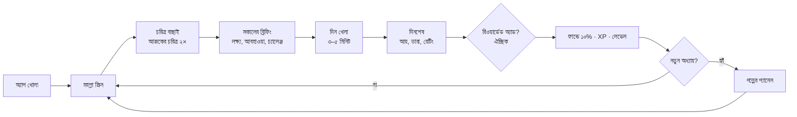

# প্রাণের ঢাকা: বিস্তারিত ডিজাইন (MVP)

*(গেমের নাম "প্রাণের ঢাকা"; আগের কাজের নাম ছিল "ঢাকার একদিন"।)*

**ভিত্তি:** `docs/GDD_v1.pdf` (Game Design Document, ২১ নভেম্বর ২০২৬)। GDD বলে *কী* বানানো হবে; এই ডকুমেন্ট বলে *ঠিক কীভাবে*, অর্থাৎ নিয়ম, সংখ্যা, স্ক্রিন, ডেটা আর কোডের গঠন। কোথাও GDD থেকে সরে গেলে বা নতুন সিদ্ধান্ত নিলে **[সিদ্ধান্ত]** লিখে চিহ্ন দেওয়া আছে। খোলা প্রশ্নগুলোর উত্তর §১৩-এ।

**সংখ্যা নিয়ে:** এখানের সব সংখ্যা (দাম, গতি, সময়) শুরুর অনুমান। প্রোটোটাইপ খেলে ঠিক করা হবে। সব সংখ্যা কোডে নয়, `content/balance.json`-এ থাকবে (§১০), পরে Remote Config দিয়ে বদলানো যাবে।

---

## ১. MVP-র সীমানা

| থাকছে | থাকছে না (পরে) |
|---|---|
| ৩টা চরিত্র: রহিম চাচা (রিকশা), বাবু (বাস কন্ডাক্টর), মনির মামা (চা-দোকান) | বাকি ৬টা চরিত্র |
| **২টা এলাকা:** মিরপুর (শুরু), পুরান ঢাকা (মহল্লা লেভেল ৫-এ খোলে) **[সিদ্ধান্ত]** | ফার্মগেট, গুলশান, যাত্রাবাড়ী (লঞ্চের পরে, মাসে একটা) |
| বাবুর ১টা রুট: মিরপুর ১০ → মতিঝিল (আর ফেরত) | অন্য রুট |
| প্রতিটা চরিত্রের ৫টা গল্পের অধ্যায় (মোট ১৫) | ৬–৭ নম্বর অধ্যায় |
| কমিউনিটি ফান্ডের ৩টা প্রকল্প | বন্যার নৌকা (স্বেচ্ছাসেবক চরিত্রের সাথে) |
| আজকের চরিত্র, দৈনিক চ্যালেঞ্জ, ৭ দিনের টানা বোনাস | সিজন পাস |
| ইভেন্ট: বর্ষা আর শীত (দুটোই আবহাওয়া), পহেলা বৈশাখ | রমজান, ঈদ, বিজয় দিবস, ২১শে ফেব্রুয়ারি (ক্যালেন্ডার অনুযায়ী Remote Config-এ) |
| Rewarded ads, দিনশেষে interstitial, Remove Ads | কসমেটিক প্যাক, সিজন পাস |
| বাংলা + ইংরেজি | অন্য ভাষা |

**কেন ২টা এলাকা:** GDD-র ৫টা এলাকা মানে রিকশার জন্য ৫টা আলাদা ম্যাপ। MVP-তে ২টাই যথেষ্ট, যাতে "নতুন এলাকা খোলে" অনুভূতিটা থাকে কিন্তু কাজের চাপ কম থাকে।

---

## ২. ডিজাইনের মূল নীতি

1. **৩–৫ মিনিটে একটা পূর্ণ দিন।** প্রতিটা দিনের শুরু, চাপ আর শেষ আছে। দিন শেষে সবসময় কিছু একটা অগ্রগতি হয়: টাকা, তারা, গল্প বা মহল্লা।
2. **মানুষ নয়, পরিস্থিতি নিয়ে হাসি।** রিকশাওয়ালা, কন্ডাক্টর, দোকানির কাজ কঠিন, কিন্তু তাঁরা দক্ষ আর মর্যাদাবান। হাসি আসবে জ্যাম, বৃষ্টি, দরদাম আর অদ্ভুত যাত্রী থেকে।
3. **একজনের কাজ অন্যজনের দিন বদলায়।** প্রতিটা সিস্টেম অন্তত একটা চরিত্রের সাথে আরেকটার যোগ তৈরি করে (§৬)।
4. **শাস্তি নয়, দ্বিতীয় সুযোগ।** খারাপ দিনেও কিছু আয় হয়। টানা খেলা না হলে কিছু হারায় না, শুধু বোনাস মেলে না।
5. **পুরো গেম অফলাইনে চলে।** ইন্টারনেট লাগে শুধু ads, কেনাকাটা আর ঐচ্ছিক আপডেটের জন্য।

---

## ৩. সেশন ও স্ক্রিন প্রবাহ



### স্ক্রিনের তালিকা

| স্ক্রিন | কী থাকে |
|---|---|
| **স্প্ল্যাশ / প্রথম খোলা** | লোগো; প্রথমবার ভাষা বাছাই (বাংলা আগে থেকে বাছা) |
| **মহল্লা (হোম)** | মহল্লার একটা ইলাস্ট্রেশন, যা আপগ্রেড আর প্রকল্পে বদলায় (বাতি জ্বলে, দোকান বড় হয়)। ওপরে টাকা, তারা আর মহল্লা লেভেল। ৩টা চরিত্রের কার্ড, "আজকের চরিত্র"-এ ২× ব্যাজ। নিচে দৈনিক চ্যালেঞ্জ, টানা খেলার দিন, ফান্ড প্রকল্পের অগ্রগতি |
| **চরিত্রের পাতা** | পোর্ট্রেট, গল্পের অগ্রগতি (৩/৫), আপগ্রেড দোকান, "দিন শুরু" বোতাম |
| **সকালের ব্রিফিং** | এক লাইনের মুহূর্ত ("আজ বৃষ্টি হতে পারে, চাচা।"), আজকের লক্ষ্য (৳৬০০), চ্যালেঞ্জ, আবহাওয়া আইকন |
| **দিন খেলা** | চরিত্রের নিজস্ব মিনি-গেম (§৪), ওপরে সময়ের ঘড়ি আর আজকের আয় |
| **দিনশেষ** | আয়ের হিসাব (আয় − খরচ − ফান্ডে ১০%), রেটিং, তারা, XP বার। "অ্যাড দেখে আয় দ্বিগুণ" বোতাম |
| **গল্পের প্যানেল** | ২–৪টা ছবি, প্রতিটার নিচে সংলাপ (ভিজ্যুয়াল নভেল ধাঁচ), ট্যাপ করে এগোনো |
| **কমিউনিটি ফান্ড** | ৩টা প্রকল্প, প্রতিটার দাম, অগ্রগতি আর সুবিধা; খেলোয়াড় একটা বেছে নেন, ফান্ড সেটায় যায় |
| **সেটিংস** | ভাষা, শব্দ, মিউজিক, কম্পন, Remove Ads কেনা, কেনাকাটা ফিরিয়ে আনা, গোপনীয়তা নীতি |

**প্রথমবার খেলা:** অ্যাপ খুললে সরাসরি রহিম চাচার একটা ছোট, গাইড করা দিন শুরু হয় (৯০ সেকেন্ড, ২টা যাত্রী, কোনো ব্যর্থতা নেই)। মহল্লা স্ক্রিন আসে তার পরে। প্রথম ৩০ সেকেন্ডেই খেলা শুরু।

---

## ৪. চরিত্রগুলোর বিস্তারিত

সব চরিত্রে কিছু জিনিস এক:
- **খেলার ঘড়ি:** দিনের কয়েক ঘণ্টা ৪ মিনিট বাস্তব সময়ে চলে।
- **দিনশেষের ফল:** একই `DayResult` গঠনে আসে (§৯)।
- **শুরুর পাঠ:** প্রথম দিনটা গাইড করা।

### ৪.১ রহিম চাচা: রিকশাওয়ালা (নেভিগেশন)

**লক্ষ্য:** দিনে কমপক্ষে ৳৬০০ আয়। বাড়তি টাকা জমে মেয়ের স্কুল ফি-র তহবিলে, যা গল্প এগিয়ে নেয়।

**ঘড়ি:** সকাল ৭টা থেকে রাত ৯টা, ৬ মিনিটে (খেলোয়াড়ের কাছে ৪ মিনিট কম লেগেছিল; `day_seconds`)। খেলায় ১ ঘণ্টা ≈ ১৭ সেকেন্ড। এনার্জি শূন্য হলে আগেই দিন শেষ ("চাচা ক্লান্ত, বাড়ি ফিরলেন")।

**ম্যাপ:**
- ওপর থেকে দেখা টাইল ম্যাপ, **আসল মিরপুরের রাস্তা দিয়ে বানানো** (OpenStreetMap থেকে): মিরপুর ১ গোলচত্বর থেকে মিরপুর ১০ গোলচত্বর, ওপরে চিড়িয়াখানা আর রূপনগর, নিচে শাহ আলী বাগ আর মনিপুর। ৫১×৫২ টাইল, প্রতিটা টাইল প্রায় ৪৫ মিটার।
- আসল রাস্তা তেরছা, তাই ম্যাপটা প্রায় ৩১° ঘোরানো, যাতে মিরপুর ১–১০-এর বড় রাস্তাটা সোজা আড়াআড়ি থাকে। বড় রাস্তা (মিরপুর রোড, বেগম রোকেয়া সরণি, চিড়িয়াখানা রোড) চওড়া করে আঁকা; গলিগুলো বাছাই করা, যাতে পাশাপাশি দুটো গলি মিশে না যায়। দুটো গোলচত্বর আছে।
- **আসল জায়গা:** যাত্রীরা আসল জায়গার নাম বলেন (মিরপুর ১০ গোলচত্বর, চিড়িয়াখানা, শেরে বাংলা স্টেডিয়াম, শাহ আলী মাজার, কমার্স কলেজ, ৬ নং বাজার, স্টার সিনেপ্লেক্স, ধানক্ষেতের মোড় …), ম্যাপে নামের ফলক থাকে। তালিকা `tool/build_map.py`-এ, আসল অক্ষাংশ-দ্রাঘিমাংশ দিয়ে।
- চায়ের দোকান, সিগন্যাল, জলাবদ্ধতা আর একমুখী গলি খেলার জন্য বসানো (আসল নয়), তবে আসল জায়গার কাছে। একমুখী গলি এমনভাবে বাছা হয় যাতে নিয়ম মেনে সব রাস্তা থেকে সব রাস্তায় যাওয়া যায়।
- পর্দায় সবসময় লেখা থাকে "Map data © OpenStreetMap contributors" (ODbL লাইসেন্সের শর্ত)।
- রাস্তা দুই ধরনের: বড় রাস্তা (দুই দিকে চলে) আর গলি (কিছু একমুখী, তীর চিহ্ন দেওয়া)।
- চিহ্নিত জায়গা: চায়ের দোকান (এনার্জি ফেরে), যাত্রী দাঁড়ানোর জায়গা, ট্রাফিক পুলিশের জায়গা।
- ম্যাপ লেখা থাকে `app/assets/content/maps/<এলাকা>.json`-এ, অক্ষরের সারি হিসেবে: `#` দালান, `O` গোলচত্বরের মাঝখান, `M` বড় রাস্তা, `.` দুই দিকের গলি, `n e s w` একমুখী গলি (যেদিকে চলা যায়), `W` জলাবদ্ধতা, `T` চায়ের দোকান, `P` সিগন্যাল, `H` রহিম চাচার বাড়ি। গলি পার হওয়া বা গলির দিকেই ঢোকা-বেরোনো চলে; গলির উল্টো দিকে চলা "উল্টো পথ"। [ফাইলটা হাতে লেখা নয়: `tool/fetch_osm.py` (GitHub-এর **osm** workflow) আসল রাস্তা নামায়, `tool/build_map.py` সেটা থেকে ম্যাপ বানায়। সিদ্ধান্ত, সপ্তাহ ২: Tiled-এর বদলে এটা, কারণ ফাইলটা পড়ে বোঝা যায়, diff-এ বদল দেখা যায়, আর validator ও test দিয়ে যাচাই হয় (সব রাস্তা থেকে সব রাস্তায় নিয়ম মেনে যাওয়া যায় কিনা)। আসল আর্ট এলে প্রতিটা অক্ষরের জায়গায় ছবি বসবে।]

**নিয়ন্ত্রণ [সিদ্ধান্ত]:**
- রিকশা রাস্তা ধরে নিজে চলে।
- মোড়ে আসার আগে সোয়াইপ করে দিক ঠিক করতে হয় (বাঁয়ে, ডানে, সোজা, ফেরা)।
- ওপরে একটা ছোট তীর গন্তব্যের দিক দেখায়।
- এতে এক হাতে খেলা যায় আর আসল চ্যালেঞ্জ থাকে "কোন রাস্তা নেব"-তে।
- **খুঁটিনাটি (সপ্তাহ ২):**
  - 3D-তে ক্যামেরা রিকশার পেছনে থাকে, তাই সোয়াইপ রিকশার দিক ধরে: বাঁয়ে বা ডানে মানে পরের মোড়ে সেদিকে বাঁক, নিচে মানে এখনই ঘোরা, ওপরে মানে মোড়ে সোজা যাওয়া। রাস্তার বাঁক সেদিকেই হলে সেটাতেই বাঁকটা ধরা হয়। (2D সংস্করণে ম্যাপ স্থির ছিল আর সোয়াইপ ছিল পর্দার দিক।)
  - কোণে পুরো ম্যাপের ছোট ছবি থাকে, রিকশা আর গন্তব্যের বিন্দুসহ।
  - **রাস্তার উচ্চতা থেকে দেখা (3D):** ক্যামেরা রিকশার ঠিক পেছনে, প্রায় সাড়ে তিন মিটার ওপরে। দৃশ্যে ১ একক = ১ মিটার, একটা টাইল ৬ মিটার, তলা ৩ মিটার। সবাই রাস্তার বাঁ দিক দিয়ে চলে।
  - **ছবির texture:** রাস্তার পিচ, ফুটপাত, প্লাস্টার, লাল ইট (প্রায় পাঁচ ভাগের এক ভাগ দালান খোলা ইটের) আর দোকানের ঢেউটিনের শাটার আসল ছবি থেকে (Poly Haven, CC0; `game/textures/SOURCES.json`)। জানালা, গ্রিল আর বৃষ্টির দাগ সেই ছবির ওপর আঁকা।
  - **খুঁটিনাটি:** বারান্দা আর রেলিং, তাতে শুকাতে দেওয়া কাপড়, AC-র বাক্স, "টু-লেট" বোর্ড, রাস্তার ওপর আড়াআড়ি টাঙানো কাপড়ের ব্যানার (ভর্তি চলছে, মূল্যছাড়…)।
  - **ভিড় চারপাশে:** দূরে চলে যাওয়া রিকশা, CNG, বাস আর মানুষ ধোঁয়াশার আড়ালে আবার চাচার ৬–১২ টাইলের মধ্যে ফিরে আসে, তাই আশপাশের রাস্তা সবসময় ব্যস্ত।
  - **শব্দ (code দিয়ে তৈরি, রেকর্ডিং পরে):** রিকশার টুংটাং ঘণ্টি (বোতাম), আশপাশের CNG আর বাসের হর্ন, অন্য রিকশার ঘণ্টি, রাস্তার একটানা গুঞ্জন।
  - **কেউ কারো ভেতর দিয়ে যায় না:** একই লেনে সামনে কেউ থাকলে থামা; মোড়ে আড়াআড়ি কেউ ঢুকে থাকলে অপেক্ষা (৩ সেকেন্ডের বেশি আটকে থাকলে ঢুকে পড়া, নইলে শহর জট পাকিয়ে যায়); দাঁড়ানো রিকশা আর ভ্যান লেনের কিনারায় লম্বালম্বি; ছোট গাড়ি মাঝখান থেকে ১ মিটার বাঁয়ে, বাস ১.৪।
  - **সিগন্যাল:** দুই রাস্তার একটায় সবুজ, অন্যটায় লাল, ১২ সেকেন্ডের চক্রে বদলায়। অন্য গাড়ি লালে থামে; চাচা লালে মোড়ে ঢুকলে ৳৫০ জরিমানা (তাঁকে নিজে থামতে হয়)।
  - **দিনের আলো:** সকালের নরম রোদ, দুপুরে সাদা, বিকেলে কমলা, রাতে নীলচে অন্ধকার; ঘড়ির সাথে বদলায়।
  - **দিন (সপ্তাহ ৩):** রাস্তার ধারে ৩–৫ জন যাত্রী, মাথার ওপর গন্তব্য আর প্রস্তাবিত ভাড়া। পাশে থামলে দরদামের পর্দা (রাজি / পাল্টা অফার / মানা)। যাত্রী উঠলে রিকশায় বসা দেখা যায়, তীর গন্তব্যে। পৌঁছালে রেটিং আর বখশিশ। পর্দায় ঘড়ি (সকাল ৭টা–রাত ৯টা, ৬ মিনিটে) আর টাকা; দিন শেষে আয়, ট্রিপ, গড় রেটিং, জরিমানা আর ৳৬০০ লক্ষ্যের হিসাব।
  - **জ্যাম (প্রাথমিক):** একই লেনে সামনে কেউ থাকলে রিকশা, CNG, বাস ধীর হয়ে থামে, লাইন দেয়; চাচার সামনে কেউ থাকলে তাঁকেও থামতে হয়। চাচা দাঁড়িয়ে থাকলে পেছনেরটা হর্ন দেয়। (পুলিশ, সিগন্যাল আর সময় নষ্টের হিসাব সপ্তাহ ৪-এ।)
  - **রাস্তার ধারে:** ফুটপাত ঘেঁষে সারি করে রাখা খালি রিকশা, ফলের ভ্যান, দোকানের সামনে দাঁড়ানো মানুষ; বড় রাস্তার ছাদে বিলবোর্ড (বানানো বিজ্ঞাপন); শাহ আলী মাজারের পাশে আর কয়েক জায়গায় মসজিদ; গলিতে খানাখন্দ আর জমা পানি; ধোঁয়াটে আকাশ; প্যাডেলের তালে ক্যামেরা হালকা দোলে।
  - **রাস্তার জীবন:** দালানে গ্রিলওয়ালা জানালা, নিচতলায় দোকানের শাটার আর বাংলা সাইনবোর্ড (নামগুলো বানানো, `content/shops.json`), ফুটপাত, বিদ্যুতের খুঁটি আর ঝোলা তার, ছাদে পানির ট্যাংক। অন্য রিকশা, CNG, বাস (শুধু বড় রাস্তায়) নিজের মতো চলে; ফুটপাতে মানুষ হাঁটে। এরা এখনো পথ আটকায় না; জ্যাম সপ্তাহ ৪-এ।
  - সোয়াইপটা মনে থাকে আর পরের যে মোড়ে সেদিকে রাস্তা আছে সেখানে কাজে লাগে।
  - পেছনের দিকে সোয়াইপ করলে সাথে সাথে ঘুরে যায়, টাইলের মাঝখানে থাকলেও।
  - কোনো সোয়াইপ না থাকলে রিকশা সোজা চলে; সোজা না গেলে একটাই বাঁক থাকলে সেটা নেয়; দুই দিকে পথ থাকলে থেমে "কোন দিকে?" জিজ্ঞেস করে। রিকশা নিজে থেকে কখনো উল্টো পথে যায় না।
  - গন্তব্য: অন্তত ৮ টাইল দূরের (নিয়ম মেনে সবচেয়ে ছোট পথে) একটা আসল জায়গা। ওপরের তীর সেদিকে মুখ করে থাকে, পাশে জায়গার নাম আর বাকি দূরত্ব।
  - জলাবদ্ধ টাইলে গতি অর্ধেক (`waterlog_speed`)।
  - **বাধা আর এনার্জি (সপ্তাহ ৪):**
    - **পুলিশ:** একমুখী গলিতে উল্টো দিকে ঢুকলে (মোড়ে বাঁক নিয়ে বা পেছনে ঘুরে) সাদা শার্ট-টুপির ট্রাফিক পুলিশ রিকশার সামনে এসে বাঁশি বাজান। ৳৫০ জরিমানা, ৫ সেকেন্ড দাঁড়িয়ে থাকা। একই গলিতে সাথে সাথে আবার জরিমানা হয় না (২০ সেকেন্ডের বিরতি)।
    - **এনার্জি:** ম্যাপের নিচে বার আর সংখ্যা; ৫০-এর নিচে হলুদ, ২০-এর নিচে লাল। ২০-এর নিচে নামলে একবার জানানো হয় "চাচা ক্লান্ত", গতি ৭০%। শূন্য হলে দিন শেষ, দিনশেষের পর্দায় প্রথম লাইন "চাচা আর পারছেন না, বাড়ি ফিরলেন"। ব্যাটারি রিকশায় খরচ অর্ধেক।
    - **চা:** চায়ের দোকানের পাশে (১ টাইলের মধ্যে) থামলে, দরদাম না চললে আর এনার্জি ৯৫-এর কম থাকলে "চা খান · ২০ টাকা" বোতাম আসে। ছোট ম্যাপে চায়ের দোকান বাদামি বিন্দু। দিনশেষে কত কাপ আর কত টাকা দেখানো হয়; মোট কাপ সেভে জমা থাকে (পরে মনির মামার নিয়মিত কাস্টমার, §৬)।
    - **বৃষ্টি:** ৪০% দিনে একবার, দিনের ১৫–৭৫% সময়ের মধ্যে, ৬০ সেকেন্ড (৬ মিনিটের দিনে ৪০ সেকেন্ড কম লাগত)। আকাশ ধূসর, রোদ কম, ধোঁয়াশা ঘন, বৃষ্টির ফোঁটা আর শব্দ। জলাবদ্ধ টাইলের পাশের টাইলেও পানি জমে (গতি অর্ধেক, যাত্রীর রেটিং কমে), প্রতি টাইলে এনার্জি ০.৪, পাল্টা অফারে রাজি হওয়ার সম্ভাবনা +২০%। বৃষ্টির ছক্কা আলাদা, তাই বৃষ্টি হোক বা না হোক বাকি দিনটা একই থাকে।

**যাত্রী আর দরদাম:**
- ম্যাপে একসাথে ৩–৫ জন যাত্রী অপেক্ষা করেন। প্রত্যেকের মাথায় গন্তব্য আর প্রস্তাবিত ভাড়া দেখা যায়।
- কাছে গেলে দরদামের ৩টা বোতাম আসে:

| বোতাম | কী হয় |
|---|---|
| **রাজি** | প্রস্তাবিত ভাড়ায় যাত্রী ওঠেন |
| **পাল্টা অফার** (ন্যায্য ভাড়ার ১.২ গুণ) | যাত্রীর ধরন অনুযায়ী রাজি হওয়ার সম্ভাবনা; না হলে চলে যান |
| **মানা** | যাত্রী থেকে যান, রহিম চাচা এগিয়ে যান |

- **ন্যায্য ভাড়া:** ৳২০ + প্রতি টাইল ৳১.৫ (১ কিমি ≈ ২২ টাইল ≈ ৳৫৩), সবচেয়ে ছোট পথে। মিরপুর ১ থেকে ১০ প্রায় ৳৭০, আসল ভাড়ার কাছাকাছি। ৫-এর গুণিতকে গোল করা হয়।
- **যাত্রীর ধরন:**

| ধরন | প্রস্তাব (ন্যায্য ভাড়ার গুণ) | পাল্টা অফারে রাজি হওয়ার সম্ভাবনা |
|---|---|---|
| সাধারণ | ০.৯–১.০ | ৬০% |
| কৃপণ | ০.৬–০.৮ | ৩০% |
| তাড়াহুড়ো (অফিসগামী) | ১.০–১.১ | ৯০% |
| বয়স্ক / মা-শিশু | ০.৮–০.৯ | ৫০%; রাজি হলে রেটিং বেশি |

- **বৃষ্টিতে:** সব যাত্রীর পাল্টা অফারে রাজি হওয়ার সম্ভাবনা আরও ২০% বেশি।

**বাধা:**

| বাধা | প্রভাব |
|---|---|
| জলাবদ্ধ টাইল | গতি অর্ধেক; যাত্রী থাকলে ঝাঁকুনিতে রেটিং −০.৫ তারা |
| একমুখী রাস্তায় উল্টো দিকে ঢোকা | পুলিশ থামায়: ৳৫০ জরিমানা আর ৫ সেকেন্ড দাঁড়িয়ে থাকা |
| ট্রাফিক পুলিশের মোড় (লাল বাতি) | ৩ সেকেন্ড অপেক্ষা; না থামলে জরিমানা |
| হঠাৎ বৃষ্টি (দিনে ০–১ বার, ৬০ সেকেন্ড) | জলাবদ্ধ টাইল দ্বিগুণ, এনার্জি খরচ বাড়ে, কিন্তু যাত্রী বেশি দেন |

**এনার্জি:**
- এনার্জি ১০০ থেকে শুরু। প্রতি টাইলে −০.২৫, বৃষ্টিতে −০.৪ (আসল ম্যাপে টাইল ছোট, তাই আগের ০.৫/০.৮ থেকে কমানো)।
- ২০-এর নিচে নামলে গতি ৭০%।
- চায়ের দোকানে থামলে ৳২০ খরচে +৪০ এনার্জি। এই কেনা মনির মামার "নিয়মিত কাস্টমার" হিসাবে গোনা হয় (§৬)।

**রেটিং (যাত্রীপ্রতি ১–৫ তারা):**
- শুরু ৫ তারা থেকে।
- প্রত্যাশিত সময়ের (পথের দৈর্ঘ্য ÷ গতি × ১.৩) পরে প্রতি ১০% দেরিতে −১ তারা।
- প্রতিটা জলাবদ্ধ টাইলে −০.৫ তারা।
- ৫ তারা পেলে যাত্রী ৳১০ বখশিশ দেন।

**দিনশেষে আয়:** ভাড়া + বখশিশ − জরিমানা − চা।

**গতি খেলোয়াড়ের হাতে [সিদ্ধান্ত]:** ডানে **প্যাডেল** বোতাম চেপে ধরলে রিকশা গতি নেয় (০.৬ টাইল/সে²), ছাড়লে গড়িয়ে ধীরে থামে (০.৩), বাঁয়ে **ব্রেক** চাপলে দ্রুত থামে (১.৫)। সর্বোচ্চ ১.৫ টাইল/সেকেন্ড, মানে প্রায় ৩২ কিমি/ঘণ্টা (খেলোয়াড়ের অনুরোধে ২০ থেকে বাড়ানো), পর্দায় দেখা যায়। এক আঙুলে প্যাডেল আর আরেক আঙুলে সোয়াইপ একসাথে চলে। আপগ্রেড: নতুন রিকশা ×১.১৫; ব্যাটারি রিকশা ×১.৫, সাথে এনার্জি খরচ অর্ধেক।

### ৪.২ বাবু: লোকাল বাস কন্ডাক্টর (টাইম-ম্যানেজমেন্ট)

**লক্ষ্য:** একটা ট্রিপে সর্বোচ্চ ভাড়া তোলা, কেউ যেন ভাড়া না দিয়ে নামতে না পারে।

**দিনের গঠন:** ২টা ট্রিপ, প্রতিটা প্রায় ২ মিনিট।
- সকালে: মিরপুর ১০ → মতিঝিল
- বিকেলে: মতিঝিল → মিরপুর ১০

**রুট (৯টা স্টপ):** মিরপুর ১০ · কাজীপাড়া · শেওড়াপাড়া · আগারগাঁও · ফার্মগেট · কারওয়ান বাজার · শাহবাগ · প্রেস ক্লাব · মতিঝিল। স্টপের মাঝে ১২–১৫ সেকেন্ড চলে।

**দৃশ্য:** বাসের ভেতর পাশ থেকে দেখা। বাঁদিকে দরজা, সামনে মহিলা আর বয়স্কদের সিট। ওপরে রুটের দাগ, যাতে বাসের অবস্থান দেখা যায়।

**ডাক মিনি-গেম (স্টপে পৌঁছানোর ২ সেকেন্ড আগে):**
- একটা টাইমিং বার এদিক-ওদিক চলে। ট্যাপ করলে বাবু স্টপের নাম ডাকেন ("ফার্মগেট! ফার্মগেট!")।
- নিখুঁত সময়ে ট্যাপ: +২ যাত্রী; ভালো: +১; ফসকালে: বাড়তি যাত্রী নেই।
- ডাকটা লেখায় বুদবুদে দেখায়, সাথে একটা সাধারণ শব্দ। আসল কণ্ঠ পরে যোগ করা যাবে (§১৩)।

**ভাড়া তোলা:**
- নতুন যাত্রীর মাথায় 💰 চিহ্ন থাকে। ট্যাপ করলে নিচে একটা প্যানেল খোলে: "শাহবাগ পর্যন্ত, ৳২০ ভাড়া; দিলেন ৳১০০"।
- ভাড়া: ৳১০ সর্বনিম্ন, প্রতি স্টপে +৳৫, সর্বোচ্চ ৳৩৫।
- **ভাংতি:** খেলোয়াড় হাতের ব্যাগ থেকে নোট টেনে ফেরত দেন।
  - দিনের শুরুতে ব্যাগে ৳২০০ ভাংতি থাকে।
  - যাত্রীর কাছ থেকে নেওয়া ছোট নোট ব্যাগে যোগ হয়।
  - ঠিক ফেরত দিলে রেটিং ভালো থাকে। কম দিলে তর্ক হয় (৩ সেকেন্ড আটকে থাকা, রেটিং কমে)। বেশি দিলে নিজের টাকা যায়।
  - ব্যাগে ভাংতি শেষ হলে "ভাংতি নেই" ঘটনা আসে: যাত্রী বিরক্ত, ২টা বিকল্প:
    - "পরে দেব": রেটিং কমে, যাত্রী নামার সময় দিতে হয়
    - "অন্য যাত্রীর থেকে ভাংতি নিন": সময় লাগে

**সিট সামলানো:**
- ২৪টা সিট (৪টা মহিলা, ২টা বয়স্ক) আর ১০ জন দাঁড়িয়ে থাকার জায়গা।
- বয়স্ক যাত্রী উঠলে কাউকে উঠিয়ে সিট দিতে হয় (ট্যাপ করে)।
- মহিলা সিটে পুরুষ বসলে ট্যাপ করে সরাতে হয়।
- ৩০ জনের বেশি হলে "ভিড়": প্রতি সেকেন্ডে রেটিং একটু কমে।

**ফাঁকিবাজ:**
- ~৮% যাত্রী নিজের স্টপে ভাড়া না দিয়ে নামার চেষ্টা করেন। দরজার দিকে গেলে হালকা জ্বলে ওঠেন।
- দরজা বন্ধ হওয়ার আগে ট্যাপ করলে ভাড়া আদায় হয়।

**চেকিং:**
- ট্রিপে ০–১ বার কোনো স্টপে চেকার ওঠেন।
- তখন বাসে কেউ ভাড়া না দিয়ে থাকলে প্রতিজনে ৳২০ জরিমানা।

**ছাত্র যাত্রী:** অর্ধেক ভাড়া দেন। রাজি হলে রেটিং বাড়ে, আয় কমে। এটা খেলোয়াড়ের নিজের সিদ্ধান্ত।

**সময়মতো পৌঁছানোর বোনাস:**
- স্টপে বেশি সময় লাগলে বাস দেরি করে।
- ট্রিপ লক্ষ্য সময়ের মধ্যে শেষ হলে +৳৫০।

**স্কোর:** তোলা ভাড়া − ফাঁকি − জরিমানা − ভুল ভাংতি + সময়ের বোনাস।

**যেভাবে বানানো হলো (সপ্তাহ ৮, `rules/bus_day.gd`, `world/bus_scene.gd`):**
- মহল্লা লেভেল ৪-এ খোলে; মহল্লার পাতায় "বাসে উঠুন"। আপাতত একটা ট্রিপ, মিরপুর ১০ থেকে মতিঝিল (দুই ট্রিপ সপ্তাহ ৯-এ)।
- দৃশ্য: বাসের পেছন থেকে সামনের দিকে দেখা (পাশ থেকে দেখার বদলে, কারণ ফোন খাড়া করে ধরা থাকে): লাল-ক্রিম দেয়াল, নীল সিট (দুই পাশে দুটো করে, ছয় সারি), ছাদের হাতল আর ঝোলানো লুপ, সামনে ডানে চালকের সিট আর স্টিয়ারিং, স্টিকার লাগানো ড্যাশবোর্ড, বাঁয়ে সামনে দরজা। জানালা দিয়ে বাইরে রাস্তা, ফুটপাত, নিচে দোকান আর ওপরে ফ্ল্যাটের সারি পেছনে সরে যায়; স্টপের আগে স্টপের নামের খুঁটি এগিয়ে আসে। যাত্রীরা সিটে বসেন, সিট ভরলে করিডোরে দাঁড়ান।
- ওপরে রুটের দাগ (৯টা বিন্দু, লাল বাস), পরের স্টপের নাম, আয় আর রেটিং।
- **ডাক:** স্টপের ২ সেকেন্ড আগে একটা বার আসে, তাতে একটা দাগ এদিক-ওদিক ছোটে; মাঝখানের সবুজ অংশে "ডাকুন!" চাপলে +২ জন, হলুদে +১। চাপলে বাসের গায়ে চাপড়ের শব্দ আর "ফার্মগেট! ফার্মগেট! ফার্মগেট!"।
- **স্টপে:** যাঁদের নামার কথা তাঁরা নামেন; ভাড়া না দেওয়া থাকলে "ভাড়া না দিয়েই নেমে গেলেন"। তারপর ১–৩ জন ওঠেন (ফার্মগেট, কারওয়ান বাজার, শাহবাগে আরও ২ জন বেশি), ডাকের বাড়তিসহ। থামার সময় ২ সেকেন্ড + প্রতি জনে ০.৪।
- **ভাড়া:** "ভাড়া নিন" চাপলে সবচেয়ে আগে ওঠা বাকি-ভাড়ার যাত্রী: কোথায় যাবেন, ভাড়া কত, কত টাকার নোট দিলেন। নোট সাধারণত ভাড়ার পরের বড় নোট (৩৫% ঠিক ভাড়া, ৫% ৫০০ টাকা)। ছাত্র হলে আগে "অর্ধেক নিন" (রেটিং +০.২) বা "পুরো চান" (রেটিং −০.২)।
- **ভাংতি:** ব্যাগে শুরুতে ২০০ টাকা (৫ টাকা ×৪, ১০ ×৫, ২০ ×৪, ৫০ ×১)। নোটের বোতাম চেপে ফেরত জমান ("ফেরত দিচ্ছেন: ৩০ টাকা"), তারপর "ফেরত দিন"। কত ফেরত দিতে হবে সেটা দেখানো হয় না, নিজে হিসাব করতে হয়। কম দিলে তর্ক (৩ সেকেন্ড বাস আটকে, রেটিং −০.৫), বেশি দিলে নিজের টাকা যায়। "পরে দেব": রেটিং −০.৫, নামার সময় ব্যাগ থেকে নিজে থেকেই দেওয়া হয়, না পারলে যাত্রী রেগে নামেন (রেটিং −১)। "অন্যের থেকে ভাংতি": ব্যাগের সবচেয়ে বড় নোট ভেঙে ছোট নোট, ৩ সেকেন্ড লাগে।
- আয় = দিন শেষে ব্যাগ কত বাড়ল + প্রতি ট্রিপে সময়মতো পৌঁছালে ৳৫০ − চেকারের জরিমানা। মহল্লার একই জমা আর তহবিলে যায়, XP রেটিং থেকে।
- **সপ্তাহ ৯:**
  - **দুই ট্রিপ:** মিরপুর ১০ → মতিঝিল, তারপর রুট উল্টে মতিঝিল → মিরপুর ১০ ("ট্রিপ শেষ! এবার ফেরার পথে")।
  - **সিট:** সামনে বাঁয়ের ২টা বয়স্কদের, সামনে ডানের ৪টা মহিলাদের (জানালার ওপরে লেখা)। বয়স্ক যাত্রী (১২%, সাদা পাঞ্জাবি) আগে নিজেদের সিটে, মহিলারা (৩৫%, এক রঙের কামিজ) নিজেদের সিটে, তারপর সাধারণ সিটে; সাধারণ সিট ভরলে পুরুষরাও বিশেষ সিটে বসেন, তারপর দাঁড়িয়ে। কোনো মুরুব্বি বা মহিলা দাঁড়িয়ে থাকলে আর তাঁদের সিটে অন্য কেউ বসে থাকলে ওপরে বোতাম আসে ("মুরুব্বি দাঁড়িয়ে! সিট ছাড়ান"); না সারালে প্রতি সেকেন্ডে রেটিং ০.০৩ কমে, সারালে +০.১। ৩০ জনের বেশি হলে "ভিড়!", রেটিং প্রতি সেকেন্ডে ০.০২ কমে।
  - **ফাঁকিবাজ (৮%):** ভাড়ার সারিতে আসেন না; নিজের স্টপে দরজায় গিয়ে দাঁড়ান, বড় লাল বোতাম "ধরুন!" আড়াই সেকেন্ড থাকে। ধরলে ঠিক ভাড়া দেন (রেটিং +০.১), না ধরলে পালান। তাঁরা দরজায় থাকতে বাস ছাড়ে না।
  - **চেকার:** অর্ধেক ট্রিপে মাঝের কোনো স্টপে ওঠেন (দরজার কাছে সাদা শার্ট); তার আগে ওঠা যাঁর ভাড়া নেওয়া হয়নি, প্রতিজনে ৳২০ জরিমানা। সবার নেওয়া থাকলে "সাবাস!"।
  - **আপগ্রেড** (মহল্লার পাতায় বাবুর কার্ডে): হিসাবের খাতা (৳৮০০, ফাঁকিবাজরাও ভাড়ার সারিতে আসেন), বড় ভাংতির ব্যাগ (৳১,৮০০, শুরুতে ৳৪০০ ভাংতি), জোরালো গলা (৳২,৫০০, নিখুঁত ডাকের অংশ দেড় গুণ)।

### ৪.৩ মনির মামা: চা-দোকানি (টাইকুন)

**লক্ষ্য:** দিনের কাস্টমার সামলানো আর দোকান বড় করা: টং → দোকান → ছোট ক্যাফে।

**ঘড়ি:** ভোর ৬টা থেকে রাত ১১টা, ৫ মিনিটে (রিকশায় ৪ মিনিট কম লেগেছিল, তাই এখানেও একটু বাড়ানো; `tea_stall.day_seconds`)।
- ভিড়ের সময়: সকাল ৭–৯টা আর সন্ধ্যা ৫–৮টা, তখন দ্বিগুণ কাস্টমার।

**দৃশ্য:** সামনে থেকে দেখা দোকান। কাউন্টারে কেটলি, কাপ, দুধ, চিনি, কলার কাঁদি, বনরুটির বয়াম আর পানের বাটা। সামনে বেঞ্চে কাস্টমার।

**অর্ডার:**
- কাস্টমার এলে মাথার বুদবুদে ১–২টা আইটেম দেখায়।
- প্রতিটা আইটেম বানাতে উপকরণ ঠিক ক্রমে ট্যাপ করতে হয়:

| আইটেম | ধাপ | দাম |
|---|---|---|
| লিকার চা | কাপ → কেটলি | ৳১০ |
| দুধ চা | কাপ → কেটলি → দুধ → চিনি | ৳১৫ |
| কলা | কাঁদি | ৳১০ |
| বনরুটি | বয়াম | ৳২০ |
| পান | পাতা → সুপারি → চুন | ৳১০ |

**ধৈর্য বার:**
- স্বাভাবিক সময় ১২ সেকেন্ড। অফিসগামীর ৮ সেকেন্ড, বয়স্কের ১৬ সেকেন্ড।
- বার শেষ হলে কাস্টমার চলে যান। ভুল ক্রমে বানালে আবার করতে হয়।

**কেটলি:** একবারে ৮ কাপ চা হয়। শেষ হলে ৫ সেকেন্ড ধরে আবার ভরতে হয়। দ্বিতীয় কেটলি কিনলে একটা ভরার সময় অন্যটা চলে।

**কাস্টমার আসার হার:** গড়ে প্রতি ৬ সেকেন্ডে একজন, ভিড়ের সময় প্রতি ৩ সেকেন্ডে।

**নিয়মিত কাস্টমার:**
- রহিম চাচা আর বাবু দিনে একবার করে আসেন। তাঁদের অর্ডার ঠিক সময়ে দিলে গল্পের ইঙ্গিত দেন ("কাল একটা ভালো যাত্রী পেয়েছিলাম…")।
- নামধারী NPC-রাও আসেন (§৬)।

**দোকানের আপগ্রেড (দুই দিনের মাঝে কেনা হয়):**

| আপগ্রেড | দাম | প্রভাব |
|---|---|---|
| বেঞ্চ | ৳৮০০ | কাস্টমার +২০%, বসা কাস্টমারের ধৈর্য +৩ সেকেন্ড |
| দ্বিতীয় কেটলি | ৳১,২০০ | ভরার সময়েও চা চলে |
| ছাউনি | ৳১,৫০০ | বৃষ্টিতেও কাস্টমার কমে না (এমনিতে ৫০% কমে) |
| ফ্রিজ | ৳৩,০০০ | নতুন আইটেম ঠান্ডা পানীয় (৳২৫), গরমের দিনে বেশি বিক্রি |
| দোকান (টং → দোকান) | ৳৫,০০০ + অধ্যায় ৩ | নতুন দৃশ্য, কাউন্টারে ২ জন কাজ করেন |

**স্কোর:** বিক্রি + খুশি কাস্টমারের সংখ্যা। কাস্টমার যত দ্রুত পান, তত খুশি; খুশি কাস্টমারের ১০% বখশিশ দেন।

**যেভাবে বানানো হলো (সপ্তাহ ৬, `rules/tea_day.gd`, `world/tea_scene.gd`):**
- মহল্লা লেভেল ২-এ খোলে (প্রথম ভালো রিকশার দিনের পরেই); মহল্লার পর্দায় "দোকান খুলুন"।
- দোকানটা মিরপুরের ম্যাপের আসল একটা চায়ের দোকানের মোড়ে (ম্যাপের মাঝখানের কাছেরটা), ফুটপাতে দেয়াল ঘেঁষে; ক্যামেরা রাস্তার ওপার থেকে। চারপাশে সেই একই শহর।
- দোকান 3D-তে: রং করা কাঠের কাউন্টার, বাঁশের খুঁটিতে টিনের চাল, কাপড়ের ঝালর, পেছনে বয়ামের তাক আর ক্যালেন্ডার, মাটির চুলায় কেটলি, কাচের গ্লাসের সারি, দুধের কৌটা, চিনির পাত্র, পানের বাটা, চালে ঝোলানো কলার কাঁদি, ওপরে "মনির মামার চা"। মনির মামা কাউন্টারের পেছনে (সাদা গেঞ্জি, নীল লুঙ্গি)। সামনে বেঞ্চে ৪ জন বসতে পারেন।
- প্রত্যেকের মাথার ওপরে কার্ড: কে (কাস্টমার / অফিসগামী / মুরুব্বি / রহিম চাচা), কী চান, ধৈর্যের বার (সবুজ → হলুদ → লাল)।
- নিচে কাউন্টারের ৯টা জিনিস বোতাম হিসেবে (চা বাদামি, নাশতা হলুদ, পান সবুজ); ওপরে "হাতে: কাপ + কেটলি", পাশে **দিন** আর **ফেলুন**।
- ধাপ মিললে জিনিসটা নিজেই সবচেয়ে কম ধৈর্য বাকি থাকা কাস্টমারের হাতে যায়। শুধু "কাপ + কেটলি"-তে (লিকার চা, কিন্তু দুধ চায়েরও শুরু) অপেক্ষা করে, যদি কেউ দুধ চা চান: তখন **দিন** চাপলে লিকার চা যায়, দুধ-চিনি দিলে দুধ চা।
- ভুল ধাপে "ভুল ক্রম", হাত খালি; কেউ না চাওয়া জিনিস নষ্ট। কেটলির শেষ কাপে জানানো হয়; খালি কেটলিতে ট্যাপ করলে ৫ সেকেন্ড ভরে।
- অর্ধেকের বেশি ধৈর্য থাকতে সব পেলে খুশি, বিলের ১০% বখশিশ (কমপক্ষে ১ টাকা)।
- কাস্টমারের ধরন: সাধারণ ৬০%, অফিসগামী ২৫%, মুরুব্বি ১৫%। অর্ডার ১টা, ৩৫% ক্ষেত্রে ২টা (দুধ চা ৪০, লিকার ২০, বনরুটি ১৪, পান ১৪, কলা ১২)।
- রহিম চাচা দিনের ২০–৭০% সময়ের মধ্যে একবার আসেন (দুধ চা আর বনরুটি), তাঁর রিকশা বেঞ্চের পাশে দাঁড়ায়। চা পেয়ে বলেন মেয়ের স্কুলের কত টাকা জমেছে, সেভ থেকে পড়ে: দুই চরিত্রের একই গল্প।
- দিনশেষে: আয়, বিক্রি, সার্ভ আর খুশির সংখ্যা, রেগে চলে যাওয়া, বখশিশ, কাস্টমারের খুশি (১ + ৪ × খুশি ÷ মোট), জমা, তহবিল (১০%), XP (রিকশার মতোই)। আয় মহল্লার একই জমায় যায়।
- **আপগ্রেড আর আবহাওয়া (সপ্তাহ ৭):** মহল্লার পাতায় মনির মামার কার্ডে পরের আপগ্রেড কেনা যায়, একই জমা থেকে, এই ক্রমে:
  - **নতুন বেঞ্চ** (৳৮০০): কাস্টমার আসে ১.২ গুণ ঘনঘন, সবার ধৈর্য +৩ সেকেন্ড; বেঞ্চে গোলাপি গদি।
  - **দ্বিতীয় কেটলি** (৳১,২০০): আরেকটা চুলায় দ্বিতীয় কেটলি; একটা খালি হলে নিজেই ভরতে বসে, ততক্ষণ অন্যটা থেকে চা যায়; বোতামে দুটোর কাপ বা "ভরছে"।
  - **ছাউনি** (৳১,৫০০): বেঞ্চের ওপর বাঁশের খুঁটিতে নীল ত্রিপল; বৃষ্টিতেও কাস্টমার কমে না।
  - **ফ্রিজ** (৳৩,০০০): দোকানের পাশে লাল ফ্রিজ, কাচের ভেতর বোতল; নতুন বোতাম "ফ্রিজ" আর নতুন অর্ডার ঠান্ডা পানীয় (৳২৫), গরমের দিনে দ্বিগুণ চাওয়া হয়।
  - দোকান (টং → দোকান) গল্পের অধ্যায় ৩-এর সাথে, পরে।
  - **বৃষ্টি:** ৪০% দিনে একবার ৬০ সেকেন্ড; আকাশ ধূসর, ফোঁটা, শব্দ; ছাউনি না থাকলে কাস্টমার অর্ধেক। বাকি দিনগুলোর ৩০% গরমের দিন।
  - **বাবু** (বাস কন্ডাক্টর) দিনে একবার আসেন, লিকার চা আর পান; চা পেয়ে মনে করিয়ে দেন মহল্লা লেভেল ৪-এ তাঁর বাস খুলবে।

---

## ৫. অর্থনীতি ও অগ্রগতি

### ৫.১ মুদ্রা

| মুদ্রা | কোথা থেকে | কোথায় খরচ |
|---|---|---|
| **টাকা (৳)** | প্রতিটা দিন খেলে (গড়ে ৳৪৫০–৮০০) | চরিত্রের আপগ্রেড |
| **তারা (⭐)** | দৈনিক চ্যালেঞ্জ (+৩), টানা খেলা (+৫ থেকে +২০), অধ্যায় শেষ (+৫), rewarded ad (+২), কেনা | আরেকবার চেষ্টা (৫), চরিত্র আগে আনলক (৩০), কসমেটিক (১০–৪০) |
| **কমিউনিটি ফান্ড** | সব আয়ের ১০%, নিজে থেকে কাটা যায় | মহল্লার প্রকল্প (§৫.৩) |

**দিন থেকে দিনে যা থেকে যায় (চালু, `rules/progress.gd`):** প্রতিটা দিনের শেষে `user://save.json`-এ জমা হয়: দিন নম্বর, আয়ের ১০% মহল্লার তহবিলে, বাকিটা চাচার জমায়; দিনের ৬০০ টাকার লক্ষ্যের বাড়তি অংশ মেয়ের স্কুল ফি-তে (লক্ষ্য ৩০০০ টাকা, গল্পের মূল কারণ); XP আর মহল্লা লেভেল; সেরা দিন; শেষ ১০ দিনের হিসাব। মহল্লার পর্দায় এগুলো দেখা যায়, জমার টাকায় নতুন রিকশা (১৫০০, গতি ×১.১৫) আর ব্যাটারি রিকশা (৬০০০, ×১.৫) কেনা যায়। দিনশেষের পর্দা দেখায় কোথায় কত গেল, লেভেল বা রেকর্ড হলো কিনা।

### ৫.২ মহল্লা লেভেল (১–৫০)

- **XP:** প্রতিটা দিনে XP = ৫০ + (দিনের রেটিং × ২০) + গল্পের অধ্যায় শেষ হলে ১০০। গড়ে দিনে ১০০–১৫০ XP।
- **পরের লেভেলে যেতে লাগে:** ৮০ + ৪০ × বর্তমান লেভেল। লেভেল ৫-এ পৌঁছাতে ~৫ দিন, লেভেল ২০-এ ~৫০ দিন।
- **লেভেলে যা খোলে:**

| লেভেল | যা খোলে |
|---|---|
| ১ | রহিম চাচা, মিরপুর |
| ২ | মনির মামা |
| ৪ | বাবু |
| ৫ | পুরান ঢাকা (রহিম চাচার দ্বিতীয় ম্যাপ) |
| ৮, ১২, ১৬… | প্রতি ৪ লেভেলে নতুন চরিত্র (লঞ্চের পরের আপডেট) |

চরিত্র আগে খুলতে চাইলে ৩০ তারা দিয়ে খোলা যায়।

### ৫.৩ কমিউনিটি ফান্ডের প্রকল্প

খেলোয়াড় একটা প্রকল্প বেছে নেন। ফান্ডের টাকা সেটায় জমা হয়, দাম পূর্ণ হলে মহল্লার ছবি বদলায় আর স্থায়ী সুবিধা আসে।

| প্রকল্প | দাম | সুবিধা |
|---|---|---|
| রাস্তার বাতি | ৳২,০০০ | সন্ধ্যায় চা-দোকানে কাস্টমার +১৫%; রাতে রিকশায় বেশি যাত্রী |
| নর্দমা পরিষ্কার | ৳৩,০০০ | মিরপুরে জলাবদ্ধ টাইল অর্ধেক |
| যাত্রী ছাউনি | ৳২,৫০০ | বাসস্টপে বৃষ্টিতেও যাত্রী কমে না |

তিনটা শেষ হলে লঞ্চের পরের আপডেটে নতুন প্রকল্প আসবে।

### ৫.৪ চরিত্রের আপগ্রেড

| চরিত্র | ধাপ ১ | ধাপ ২ | ধাপ ৩ |
|---|---|---|---|
| রহিম চাচা | নতুন রিকশা ৳১,৫০০ (গতি ×১.১৫) | ব্যাটারি রিকশা ৳৬,০০০ (গতি ×১.৫, এনার্জি খরচ অর্ধেক) | রিকশা আর্ট (কসমেটিক, তারা দিয়ে) |
| বাবু | ছোট খাতা ৳৮০০ (কে ভাড়া দেননি, তালিকায় দেখা যায়) | ভাংতির ব্যাগ ৳১,৮০০ (শুরুতে ৳৪০০ ভাংতি, নোট টানা দ্রুত) | গলার জোর ৳২,৫০০ (ডাকের নিখুঁত অংশ বড়) |
| মনির মামা | §৪.৩-এর টেবিল | | |

---

## ৬. চরিত্রদের মধ্যে সংযোগ

### ৬.১ ফিরে আসা মানুষ (নামধারী NPC)

- ২০ জন নামধারী মানুষ আছেন, যেমন রুমানা আপা (স্কুল শিক্ষিকা), কামাল ভাই (অফিসের কেরানি), ফারহান (কলেজ ছাত্র)।
- প্রত্যেকের একটা **সম্পর্ক** মান আছে, −৫ থেকে +৫।
- এক চরিত্রের দিনে এঁদের সাথে কেমন ব্যবহার হলো, তা অন্য চরিত্রের দিনে ফল আনে:

| কী হলো | পরে কী হয় |
|---|---|
| রহিম চাচা ৫ তারায় পৌঁছে দিলেন | সেই NPC পরে চা-দোকানে আসেন, ৳২০ বখশিশ দেন আর এক লাইন বলেন ("চাচা কাল দারুণ চালিয়েছেন!") |
| বাবু ছাত্রকে অর্ধেক ভাড়ায় নিলেন | ফারহান পরে রহিম চাচার যাত্রী হয়ে বেশি ভাড়া দেন |
| কাউকে খারাপ ব্যবহার (পাল্টা অফারে রাজি না হলে বা দেরিতে চা) | তিনি অভিযোগ করেন; মহল্লার মেজাজ একটু কমে, যা দৈনিক চ্যালেঞ্জ কঠিন করে |

- এই সব ঘটনা একটা "মহল্লার ঘটনার খাতা"-য় জমা হয় (§৯.৩)। পরের দিনগুলো সেখান থেকে বেছে নিয়ে দেখায়।

### ৬.২ গল্পের অধ্যায় (MVP-তে প্রতিজনের ৫টা)

অধ্যায় খোলে টাকা জমানো আর দিনের সংখ্যা মিলিয়ে, যাতে শুধু অনেক খেললেই নয়, ভালো খেললেও খোলে।

| চরিত্র | অধ্যায় ও কখন খোলে (মোটামুটি) |
|---|---|
| **রহিম চাচা** | ১. শহরে প্রথম দিন (গাইড করা দিন) · ২. মেয়ে সুমির ভর্তির খবর (৩ দিন) · ৩. বৃষ্টির রাতে এক অসুস্থ যাত্রী (মোট ৳৩,০০০) · ৪. নতুন রিকশা (আপগ্রেড কিনলে) · ৫. সুমির ভর্তি (মোট ৳৮,০০০ জমা) |
| **বাবু** | ১. প্রথম রুট · ২. ড্রাইভার ওস্তাদের সাথে ঝগড়া · ৩. হারানো মানিব্যাগ (সৎ থাকার সিদ্ধান্ত) · ৪. বাড়িতে টাকা পাঠানো · ৫. নিজের বাসের স্বপ্ন |
| **মনির মামা** | ১. টং খোলা · ২. প্রথম নিয়মিত কাস্টমার · ৩. টং থেকে দোকান (আপগ্রেড) · ৪. বৃষ্টিতে পুরো মহল্লা দোকানে · ৫. ছোট ক্যাফের পরিকল্পনা |

প্রতিটা অধ্যায় ২–৪টা ছবির প্যানেল আর ৬–১২ লাইন সংলাপ। সব লেখা `content/story/*.json`-এ থাকবে, বাংলা ও ইংরেজিতে।

**যেভাবে বানানো হলো (সপ্তাহ ১০):**
- **গল্প** (`content/story.json`, `rules/story.gd`, `ui/story_player.gd`): ১৫টা অধ্যায়, বাংলা ও ইংরেজিতে। নতুন চরিত্র: রহিম চাচার স্ত্রী রোকেয়া, মেয়ে সুমি; বাসের চালক ওস্তাদ, বাবুর মা। প্রতিটা চরিত্রের প্রথম অধ্যায় তাঁর প্রথম দিনের আগে নিজে থেকেই আসে; বাকিগুলো খোলে দিনের সংখ্যা (রহিম ২: ৩ দিন; মনির ২: ২ দিন, ৪: ৫ দিন; বাবু ২: ২ দিন, ৩: ৪ দিন, ৫: ৮ দিন), আয় (রহিম ৩: ৳৩,০০০; বাবু ৪: ৳২,০০০), আপগ্রেড (রহিম ৪: নতুন রিকশা; মনির ৩: বেঞ্চ, ৫: ফ্রিজ) আর স্কুল ফি পূর্ণ হলে (রহিম ৫)। মহল্লার পাতায় "নতুন অধ্যায় এসেছে!"। পড়লে +১০০ XP আর +৫ তারা।
- পড়ার পর্দা: ওপরে দৃশ্যের ছবি (আসল আর্ট আসার আগে আঁকা: ভোরের উঠোন আর টিনের ঘর, সকালের রাস্তা আর রিকশা, চায়ের টং, বাসের ভেতর, বৃষ্টির রাত, স্কুল আর পতাকা, হাসপাতাল), নিচে দৃশ্যের মানুষজন, যিনি কথা বলছেন তিনি একটু উঁচু আর হলুদ বৃত্তে; তার নিচে নামসহ সংলাপ, ট্যাপে পরের লাইন, "এড়িয়ে যান"। বাবুর অধ্যায় ৩-এ সিদ্ধান্ত: মানিব্যাগ ফেরত দিলে ৳২০০ আর কামাল ভাই খুশি (+৩); রেখে দিলে ৳৫০০ কিন্তু কামাল ভাই নাখোশ (−৩)। "গল্প (n/১৫)" থেকে পড়া অধ্যায় আবার পড়া যায়।
- **প্রতিবেশী** (`content/npcs.json`, `rules/neighbours.gd`): ২০ জন। প্রতিদিন ৬ জন বেছে নেওয়া হয়; রিকশায় ২৫%, চায়ের দোকানে ২০%, বাসে ১২% যাত্রী/কাস্টমার তাঁদের কেউ (ফারহান বাসে ছাত্র)। নাম দেখা যায় মাথার ওপরের লেখায়, দরদামের পর্দায়, চায়ের কার্ডে, ভাড়ার পর্দায়। মন বাড়ে: ৪.৫ তারার রিকশা, খুশি মনে চা, ছাত্র ভাড়া মেনে নেওয়া; কমে: খারাপ যাত্রা, পাল্টা অফারে চলে যাওয়া, চায়ের অপেক্ষায় চলে যাওয়া, পুরো ছাত্র ভাড়া, ভাংতি নিয়ে তর্ক। মন +৩ বা বেশি হলে রিকশায় আর চায়ে ৳২০ বাড়তি বখশিশ, বাসে ঠিক ভাড়ার নোট। "মহল্লার খাতা"-য় সবার মন আর সাম্প্রতিক ৮টা ঘটনা।

---

## ৭. দৈনিক কাঠামো ও ইভেন্ট

- **আজকের চরিত্র:**
  - তারিখ থেকে হিসাব করা হয় (খোলা চরিত্রগুলো ক্রমে ঘোরে), তাই সার্ভার লাগে না।
  - সেই চরিত্রে প্রথম দিনে ২× আয় পাওয়া যায়।
  - অন্য চরিত্রও যতবার খুশি খেলা যায়।
- **দৈনিক চ্যালেঞ্জ:** টেমপ্লেট থেকে তারিখ ধরে বাছাই। ৩টা উদাহরণ:
  - "১০ জন যাত্রীকে ৩ তারার বেশি সার্ভিস দাও"
  - "কোনো ফাঁকিবাজ যেন না নামে"
  - "সকালের ভিড়ে ২০টা চা"
- **টানা খেলার বোনাস:**

| দিন | পুরস্কার |
|---|---|
| ১ | +৫ তারা |
| ২ | +৫ তারা |
| ৩ | +১০ তারা |
| ৪ | +১০ তারা |
| ৫ | +১০ তারা |
| ৬ | +১৫ তারা |
| ৭ | বিশেষ জিনিস (রিকশার নকশা, ঈদের পোশাক ইত্যাদি) |

  এক দিন বাদ পড়লে গুনতি আবার ১ থেকে শুরু হয়, কিন্তু আগে পাওয়া পুরস্কার থেকে যায়।
- **যেভাবে বানানো হলো (সপ্তাহ ১০, `rules/daily.gd`):** আজকের চরিত্র খোলা চরিত্রদের মধ্যে তারিখ ধরে ঘোরে; তাঁর প্রথম দিনে আয় ২×। চ্যালেঞ্জ ৯টা থেকে (প্রতি চরিত্রে ৩টা: রিকশায় ৪ তারার ৪টা ট্রিপ / জরিমানা ছাড়া ৩ ট্রিপ / ৮০০ টাকা; চায়ে ১২ জন খুশি / ১০ জনের কেউ রাগেনি / ১৫ কাপ দুধ চা; বাসে কেউ ফাঁকি দেয়নি / দুই ট্রিপ সময়মতো / ৪০ জন যাত্রী), খোলা চরিত্রদেরগুলো থেকে তারিখ ধরে একটা; পূরণে +৩ তারা, দিনে একবার। টানা খেলা ফোনের তারিখ ধরে; সপ্তম দিনের বিশেষ জিনিস রহিম চাচার রিকশার উৎসবের হুড (টিপ বসানো নকশা)। মহল্লার পাতায় "আজকের দিন" কার্ড, তারা আর টানা দিনের সংখ্যা; ৩০ তারা থাকলে বন্ধ চরিত্র আগেই খোলা যায়।
- **আবহাওয়া:**
  - প্রতিটা দিনে আবহাওয়া এলোমেলোভাবে বাছা হয়, সম্ভাবনা মাস অনুযায়ী।
  - জুন–সেপ্টেম্বর: ৪০% বৃষ্টি। ডিসেম্বর–জানুয়ারি: ৩০% কুয়াশা, তাতে রিকশার ম্যাপে দূরের রাস্তা কম দেখা যায়।
- **ক্যালেন্ডারের ইভেন্ট:**
  - প্রতিটা ইভেন্ট `content/events.json`-এ একটা তারিখের পরিসর আর পরিবর্তনের তালিকা।
  - রমজান আর ঈদের তারিখ চাঁদ দেখার ওপর নির্ভর করে, তাই কোডে হিসাব না করে Remote Config থেকে আসবে।
  - GDD অনুযায়ী রাজনৈতিক ইভেন্ট (হরতাল, মিছিল) থাকবে না।

---

## ৮. আয়ের মডেল (বিস্তারিত নিয়ম)

| ধরন | কখন | নিয়ম |
|---|---|---|
| **Rewarded: আয় দ্বিগুণ** | দিনশেষের স্ক্রিনে | দিনে সর্বোচ্চ ৩ বার |
| **Rewarded: আরেকবার চেষ্টা** | দিনটা খারাপ গেলে, তারার বদলে | দিনে ২ বার |
| **Rewarded: +২ তারা** | মহল্লা স্ক্রিনে একটা বাক্স | দিনে ৩ বার |
| **Interstitial** | দিনশেষের স্ক্রিন বন্ধ করার পর | প্রতি তৃতীয় দিনশেষে, দিনে সর্বোচ্চ ৩টা; প্রথম ৩ দিনে একটাও নয়; খেলার মাঝখানে কখনো নয় |
| **Remove Ads** | সেটিংস আর দিনশেষের স্ক্রিন | ~৳১২০, interstitial বন্ধ (rewarded থাকে, খেলোয়াড় নিজে চাইলে) |
| **তারার প্যাক** | দোকান | ছোট প্যাক; শুধু সময় বাঁচায়, এমন কোনো জিনিস কেনা যায় না যা খেলায় সুবিধা দেয় |

- **বয়সের দিক:** লক্ষ্য খেলোয়াড় ১৪+ বছর। Google Play-তে টার্গেট অডিয়েন্স "১৩+" দিলে Families নীতি লাগে না।
- **Ads-এর ধরন:** AdMob-এ ads "Teen" মানের রাখতে হবে।
- **পেমেন্ট:** বাংলাদেশে Google Play-র কেনাকাটায় কোন পেমেন্ট পদ্ধতি চলে, লঞ্চের আগে যাচাই করতে হবে (GDD-র কথা অনুযায়ী)।

---

## ৯. কারিগরি ডিজাইন

### ৯.১ স্ট্যাক

| অংশ | পছন্দ | মন্তব্য |
|---|---|---|
| ইঞ্জিন | **Godot 4.5, 3D** (Compatibility renderer, OpenGL ES 3) **[সিদ্ধান্ত, সপ্তাহ ২]** | কম দামের ফোনেও চলে; বিনামূল্যে, open source; GitHub Actions-এ APK বানানো যায়। প্রথম দুই সপ্তাহ Flutter + Flame 2D-তে হয়েছিল |
| ভাষা (কোড) | GDScript | নিয়মের অংশ (`scripts/rules`) আঁকা থেকে আলাদা, headless test চলে |
| ম্যাপ | অক্ষরের সারি দিয়ে লেখা JSON, নিজের `RoadMap` (§৪.১) | একই ফাইল থেকে 3D শহর বানানো হয় |
| সেভ | একটা JSON ফাইল `user://save.json`-এ, atomic write | GDD-র Hive-এর বদলে |
| সেটিংস | `ConfigFile` (`user://settings.cfg`) | ভাষা, শব্দ |
| অডিও | Godot-এর `AudioStreamPlayer`, OGG | |
| Ads | AdMob-এর Godot Android plugin | সপ্তাহ ১১-এ বাছাই |
| কেনাকাটা | Google Play Billing-এর Godot plugin | |
| Analytics, Crash, Remote Config | Firebase, Godot Android plugin দিয়ে | Firebase না থাকলে চুপ থাকে; সপ্তাহ ১১-এ বাছাই |
| লেখা | `content/strings.json`, প্রতিটা লেখা `{bn, en}`; Hind Siliguri ফন্ট | Godot-এর text server (HarfBuzz) যুক্তাক্ষর জোড়ে |

### ৯.২ কোডের গঠন

```
game/
  project.godot, export_presets.cfg
  scenes/          # main.tscn (মহল্লা), rickshaw.tscn …
  scripts/
    rules/         # ম্যাপ, চলা, দিন, ব্যালান্স: আঁকা ছাড়া, test সহ
    world/         # 3D: শহর বানানো, রিকশার মডেল, দৃশ্য, ক্যামেরা
    ui/            # মহল্লা, HUD, লেখা, রঙ-ফন্ট
    economy/ story/ save/ services/   # পরের সপ্তাহগুলোতে
  content/         # balance.json, strings.json, maps/, পরে passengers, npcs, story …
  fonts/           # Hind Siliguri
  tests/           # run_tests.gd (headless), shots.gd (screenshot)
tool/              # validate_content.py, fetch_osm.py, build_map.py
keys/dev.keystore  # পরীক্ষার APK-র সই (Play-র key আলাদা, GitHub secret-এ)
```

### ৯.৩ চরিত্রের interface

প্রতিটা চরিত্র একই চুক্তি মানে। নতুন চরিত্র মানে নতুন ফোল্ডার, বাকি গেম বদলায় না।

```gdscript
# DayContext (Dictionary বা ছোট class): যা একটা চরিত্র দিনের শুরুতে পায়
#   date, weather ("clear" | "rain" | "fog"), events, upgrades, perks,
#   visitors (আজ আসবেন এমন NPC), challenge, featured (আজকের চরিত্র: আয় ২×),
#   rng (দিনের seed: আবার খেললে একই দিন)
#
# DayResult: যা দিনশেষে ফেরত আসে
#   earned (১০% ফান্ডের আগে), spent (জরিমানা, চা, ভুল ভাংতি), rating (১–৫),
#   npc_outcomes, stats (চ্যালেঞ্জ আর analytics), challenge_met

# প্রতিটা চরিত্রের ফোল্ডারে একটা script এই চুক্তি মানে:
extends RefCounted
func id() -> String: return "rickshaw"          # "bus", "tea_stall"
func create_day(ctx: Dictionary, on_end: Callable) -> Node3D: ...
func briefing(ctx: Dictionary) -> Control: return null   # ঐচ্ছিক সকালের পর্দা
```

### ৯.৪ সেভের গঠন (`save.json`)

**অনলাইন ব্যাকআপ [সিদ্ধান্ত, ২১ নভেম্বর ২০২৬] (`ui/cloud.gd`):** খেলতে লগইন লাগে না। Firebase-এর সাধারণ HTTPS API দিয়ে (Android plugin ছাড়া): প্রথমবার নিজে থেকে একটা নামহীন account, প্রতিটা দিনের শেষে আর মহল্লার পাতায় ফিরলে পুরো `save.json` Firestore-এর `players/<account>`-এ জমা (নিয়ম: প্রত্যেকে শুধু নিজেরটা পড়তে-লিখতে পারে)। ইন্টারনেট না থাকলে খেলা চলে, পরে জমা হয়। নতুন ফোনে নেওয়ার জন্য ঐচ্ছিক "ইমেইল দিয়ে সংরক্ষণ" (নামহীন account-টাই ইমেইল-পাসওয়ার্ডে বাঁধা হয়) আর "অন্য ফোন থেকে আনুন" (সেই ইমেইলে ঢুকে অগ্রগতি দেখিয়ে নিশ্চিত করলে বদলায়)। Google দিয়ে ঢোকা Play Store-এর সময় (Play Games-এর সাথে)। Project ID আর web API key repo-র GitHub secret থেকে build-এর সময় `content/cloud.json`-এ লেখা হয় (git-এ নেই); Firebase-এর নিয়মে এগুলো APK-তে থাকেই, নিরাপত্তা আসে Firestore-এর নিয়ম থেকে। build প্রতিবার আসল Firebase-এ একটা account বানিয়ে, জমা দিয়ে, পড়ে, মুছে পরীক্ষা করে (`tests/cloud_check.gd`)।

**বন্ধুদের সাথে খেলা [ধাপ ৫, ২৪ নভেম্বর ২০২৬] (`rules/friends.gd`, `ui/home.gd`-এর "বন্ধুরা" পাতা):** একই সময়ে online থাকতে হয় না। প্রত্যেকে একটা নাম বেছে ৬ অক্ষরের কোড পায় (I, O, 0, 1 বাদ; `codes/<কোড>` → account)। অন্যরা দেখে শুধু একটা ছোট কার্ড (`profiles/<account>`): বাছাই করা নাম, কোড, লেভেল, এই আর গত সপ্তাহের আয়, তহবিলে মোট দেওয়া, আজকের পালার ভাগ; email, ফোন নম্বর বা পুরো save কখনো না। বন্ধু ২০ জন পর্যন্ত; বাদ দেওয়া আর ব্লক করা যায় (ব্লক করলে তার জিনিস ফেলে দেওয়া হয়)।
- **সপ্তাহের তালিকা:** সপ্তাহ শনিবার থেকে। নতুন সপ্তাহে গত সপ্তাহে বন্ধুদের মধ্যে প্রথম (আয় আছে, অন্তত একজন বন্ধু খেলেছে) হলে রিকশার সোনালি রং (দোকানে বিক্রি হয় না), আগে থাকলে +১০ তারা।
- **উপহার আর স্টিকার** (`inbox/<account>/items`): দিনে ৩টা উপহার (চা: রহিম চাচার পরের দিনে কাপে +১০ শক্তি, ৩ কাপ পর্যন্ত; পান: +২ তারা), ১০টা স্টিকার (৬টা বাছাই করা কথা; নিজে লেখা কথা নয়)।
- **যৌথ তহবিল:** আমার আর বন্ধুদের মহল্লা-তহবিলে মোট দেওয়া (আয়ের ১০%) মিলিয়ে মহল্লার স্কুল (২০,০০০), খেলার মাঠ (৪০,০০০), পাঠাগার (৬০,০০০); প্রতিটা হলে +১০ তারা।
- **পালার দিন:** সকালে মনির মামা, দুপুরে রহিম চাচা, সন্ধ্যায় বাবু। আজ বন্ধুর দোকান ৩.৫ তারা বা বেশি হলে রহিম চাচার +২০ শক্তি; বন্ধুর রিকশা ভালো হলে বাবুর আয় +১০%। তিন ভাগই আজ খেলা হলে (নিজে আর বন্ধুরা মিলে, অন্তত একজন বন্ধু) +৫ তারা।
- কার্ড লেখা হয় দিনের শেষে আর মহল্লায় ফিরলে; বন্ধুদের কার্ড আর পাঠানো জিনিস আসে মহল্লায় ফিরলে আর বন্ধুদের পাতা খুললে। Firestore-এর নিয়ম Firebase console-এ (repo-তে নয়): `codes` শুধু নিজের account-এর নামে নতুন বানানো যায়; `profiles` সবাই পড়ে, লেখে শুধু নিজে; `inbox` পাঠায় যে কেউ নিজের নামে, পড়ে আর মোছে শুধু মালিক। build-এর `cloud_check.gd` এগুলোও পরীক্ষা করে।

**ধাপ ০–৫ মিলিয়ে দেখা [২৫ নভেম্বর ২০২৬]:** পরিকল্পনার যা বাদ পড়েছিল তা যোগ হলো।
- **শেয়ার কার্ড:** দিনশেষে রিকশা-আর্ট ফ্রেমে দিনের এক লাইন, WhatsApp বা Facebook-এ পাঠানো (সাথে খেলার web ঠিকানা); ব্রাউজারে ফোনের নিজের share।
- **সহজ চালানো:** নিজে থেকে মোড় নেওয়ার সাথে রাস্তায় ৪০% কম গাড়ি, জরিমানা আর পুলিশের আটকে রাখা অর্ধেক; বদলে ভাড়া ১০% কম।
- **SMS যাচাই চায়ের দোকানে আর বাসেও** (১২%): ভুয়া বিশ্বাস করলে টাকা যায়, আসলকে সন্দেহ করলে কাস্টমার অখুশি বা বাসের রেটিং কমে।
- **হুড:** হাতের খেলা চালু থাকলে বৃষ্টি থামলেও হুড নিজে নামে না; তোলা থাকলে রিকশা ধীর, "হুড নামান" বোতাম।
- **বাসা থেকে ফোন** আসে থামা অবস্থায় (রিকশা দাঁড়ানো, দোকানে একজনের বেশি নেই, বাস স্টপে), নইলে আধা মিনিট পরে; ফোনের কথা ৬/৫/৫টা। পরিবারের মন ৮ হলে খুশির দৃশ্য, ২ হলে অভিমানের দৃশ্য (একবার করে)।
- **বাসে সিট:** সিট দরকার এমন যাত্রী এক স্টপ দাঁড়িয়ে থাকলে নেমে যান, রেটিং ০.৩ কমে।
- **চায়ে অর্ডার বদল:** লেভেল ৩ থেকে লুকানো অর্ডার মাঝে মাঝে বদলায় ("না মামা, লিকার চা-ই দেন")।
- **রমজানে চায়ের দোকান:** দিনে ভিড় কম; বিকেল ৫টা–৭টায় প্রতি কাস্টমার ৪০ টাকার ইফতারের প্যাকেট নেন।
- **রফিক চাচার খবর:** একই তারিখে সবার আবহাওয়া এক (তারিখ ধরে), তাই খবরে আগামীকালের বৃষ্টির কথা আগে থেকেই।
- **বাসার জিনিসে দৃশ্য:** চৌকি, ফ্যান, টেবিল, টিভি, পাকা ঘর কিনলে পরিবারের ছোট দৃশ্য (story.json-এর scenes), দোকান থেকে আবার দেখা যায়।
- **মহল্লার খাতা:** প্রতিবেশীর নামে চাপ দিলে তাঁর পাতা: কাজ, আপনার প্রতি মন, তাঁর গল্পের কত অধ্যায় পড়া, সাম্প্রতিক ঘটনা।
- **গল্পের প্রভাব খেলায়:** রিকশা আটক (নিয়ম মেনে) → ৩ দিন ভাড়ার রিকশা, ১৫% ধীর; রোকেয়ার অসুখ → ৩ দিন দিন ২০% ছোট; গ্রামে বন্যা → ৭ দিন লক্ষ্য ২০০ টাকা বেশি; উচ্ছেদ → এক দিন কাস্টমার কম; ম্যাচের রাত → এক দিন দ্বিগুণ ভিড়। শুরুর পাতায় আর দিনের শুরুতে লেখা থাকে।
- **পড়ে শোনানো:** মহল্লায় কার্ড, বোতাম বা লেখায় আঙুল চেপে ধরলে সেটা পড়ে শোনায়।
- বাগ: রফিক চাচার খবরের শিরোনাম এক অক্ষর করে ভাঙত; অনলাইন কপি শেষ হলে খোলা গল্প মাঝপথে বন্ধ হয়ে যেতে পারত।

**লিডারবোর্ড, তারার দোকান, চা আর বাসের বদল [সিদ্ধান্ত, ২৫ নভেম্বর ২০২৬]:**
- **চায়ের অর্ডার মনে রাখা বাদ** (জটিল লাগে): সব অর্ডার কার্ডে থাকে; অর্ডার বদলও তাই আর আসে না।
- **বাসে ৫০০ টাকার ভাংতি:** থলে শুরু হয় ৫৫০ টাকার নোটে (৩টা ১০০, ২টা ৫০ সহ), তাই শুরু থেকেই ৫০০ ভাঙানো যায়। নামার স্টপে ভাংতি না থাকলে হাতের নোট থলেতে, বড় নোট ভাঙানো (দেরি ছাড়া); তবুও না হলে বাবু মোবাইলে ফেরত পাঠান: যাত্রীর ক্ষতি নেই, দিনের আয় থেকে কাটে, রেটিং মাত্র ০.১ কমে।
- **লিডারবোর্ড (সব খেলোয়াড়, `rules/leaderboard.gd`):** আজ, সপ্তাহ (শনিবার থেকে), মাস আর সব সময়; প্রতিটা চরিত্রের আয় আর সব মিলিয়ে। নিজের কার্ডে (`profiles/<account>`) সময়ের নামে ঘর থাকে (`lb_d20261125_rickshaw` ইত্যাদি), এখনকার আর ঠিক আগের সময়ের; তালিকা = সেই ঘর ধরে সাজানো প্রথম ২০ জন, নিজের স্থান গুনে বের করা। নাম না দিলে "খেলোয়াড়" আর account-এর ৪ অক্ষর। আগে বলা ছিল শুধু বন্ধুদের মধ্যে তালিকা (প্রতারণা ধরা কঠিন বলে); এখন সবার তালিকা, ঝুঁকিটা জেনে।
- **শীর্ষ ৩-এ তারা:** দিন শেষ হলে ৫/৩/২, সপ্তাহ ১৫/১০/৫, মাস ৪০/২৫/১৫; পরেরবার খেলা খুললে নিজে নিজে পাওয়া যায়, একবার করে। সব সময়ের তালিকায় পুরস্কার নেই।
- **তারার দোকান:** প্রতি চরিত্রের দোকানের পাতায়: একটা সাজ (রাতের আকাশ রং ৪০, তারার সাইনবোর্ড ৩০, তারার স্টিকার ৩০) আর পরের দিনের সুবিধা ৮ তারায় (ভালো খাবার +৩০ শক্তি; মাইকে প্রচার ৩০% বেশি কাস্টমার; খুচরা নোটের বান্ডিল ২৩০ টাকা)।

**চতুর্থ চরিত্র: জুলেখা খালা, ফুচকাওয়ালি [ধাপ ৬, ২৫ নভেম্বর ২০২৬] (`rules/fuchka_day.gd`, `world/fuchka_scene.gd`):** লেভেল ৬-এ খোলে (বা ৩০ তারায় আগে)। মিরপুরের মনিপুর স্কুলের গেটে গাড়ি (খুঁটি নেই এমন ফুটপাতে), দুপুর ১টা থেকে রাত ৯টা, ৫ মিনিটের দিন। গাড়ির সামনে ৪ জন দাঁড়ায়, প্রত্যেকের কার্ডে চাওয়া টক (১–৩) আর ঝাল (০–৩): শিশু কম ঝাল, কলেজের ছাত্রী বেশি টক, অফিসের লোক বেশি ঝাল, পরিবার মাঝামাঝি; স্কুল ছুটির পর সুমি আসে (ঝাল ছাড়া, টক ২)। প্লেট: ফুচকা ফাটানো → আলু-মটর → টক → ঝাল (দই থাকলে দই), তারপর কার্ডে চাপলে দেওয়া। মাপ একদম ঠিক হলে বখশিশ ১০ + দামের ১৫%, এক ঘর এদিক-ওদিক হলেও খুশি, বেশি ভুল হলে অখুশি। হাতের খেলা চালু থাকলে ফুচকা ফাটানো (আলতো টোকা, বেশি চাপলে ভাঙে) আর টক ঢালা (জগ চেপে ধরে মাপ) আলাদা ছোট খেলা। ভিড়: স্কুল ছুটি (১:৩০–২:৩০) আর সন্ধ্যা (৬–৮); বৃষ্টিতে না ঢাকলে কাস্টমার অর্ধেক আর ফুচকা নরম (এক ঘর ভুল); শীতে ভিড় বেশি। upgrade: টুল (৮০০, ধৈর্য বেশি), বড় ছাতা (১৫০০, বৃষ্টিতে সবসময় ঢাকা), দইয়ের হাঁড়ি (২৫০০, দই ফুচকা ৬০ টাকা)। গাড়ির রং কেনা যায় (তারা দিয়েও), তারার সুবিধা "রঙিন দামের বোর্ড"। ছেলে রানা বাসা থেকে ফোন করে। গল্পের ৫ অধ্যায়: গাড়ির শুরু আর সুমির সাথে দেখা, সুমির বান্ধবী আর রুমানা আপা, টাকার টানাটানি (রোকেয়ার সমিতি নাকি মহাজন), বৃষ্টিতে মনির মামার ছাউনি, স্কুলের গেটে উচ্ছেদের নোটিশ। দৈনিক চ্যালেঞ্জ, লিডারবোর্ড, ডবল টাকার দিন সবকিছুতে জুলেখা খালা আছেন।

```json
{
  "schema": 1,
  "taka": 2350, "tara": 41, "fund": 640,
  "fundProject": "street_lights",
  "mohalla": {"level": 6, "xp": 210, "projectsDone": ["drain_cleaning"]},
  "characters": {
    "rickshaw": {"unlocked": true, "days": 14, "saved": 4200,
                 "upgrades": ["new_rickshaw"], "chapter": 3},
    "bus": {"unlocked": true, "days": 3, "upgrades": [], "chapter": 1},
    "tea_stall": {"unlocked": true, "days": 9, "upgrades": ["bench", "kettle2"], "chapter": 2}
  },
  "npcs": {"rumana": 3, "kamal": -1},
  "pendingVisits": [{"npc": "rumana", "at": "tea_stall", "kind": "thanks"}],
  "streak": {"count": 4, "lastDay": "2026-12-03"},
  "daily": {"date": "2026-12-03", "featuredPlayed": false, "adsDoubled": 1},
  "purchases": {"remove_ads": false},
  "settings": {"lang": "bn"}
}
```

- প্রতিটা দিন শেষ হলেই সেভ হয়। আগে নতুন ফাইলে লেখা হয়, তারপর নাম বদলে আগেরটার জায়গায় বসে, যাতে মাঝপথে বন্ধ হলেও সেভ নষ্ট না হয়।
- `schema` নম্বর দিয়ে পরের সংস্করণে পুরোনো সেভ আপডেট করা হয়।

### ৯.৫ Content (কোড না ছুঁয়ে বদলানো যায়)

| ফাইল | কী থাকে |
|---|---|
| `balance.json` | সব সংখ্যা: গতি, ভাড়া, ধৈর্য, দাম, XP, অ্যাডের সীমা |
| `passengers.json` | যাত্রীর ধরন, প্রস্তাবের গুণ, রাজি হওয়ার সম্ভাবনা, সংলাপ |
| `npcs.json` | ২০ জন নামধারী মানুষ, তাঁদের সংলাপ আর পুরস্কার |
| `story/*.json` | অধ্যায়: শর্ত, প্যানেলের ছবি, সংলাপ `{bn, en}` |
| `challenges.json` | দৈনিক চ্যালেঞ্জের টেমপ্লেট |
| `events.json` | ইভেন্টের তারিখ আর পরিবর্তন |
| `tea_menu.json`, `bus_route.json` | রেসিপি, স্টপ আর ভাড়া |

একটা যাচাই স্ক্রিপ্ট (`tool/validate_content.py`) CI-তে সব ফাইল পরীক্ষা করবে: দুই ভাষা আছে কি না, আইডি মেলে কি না, সংখ্যা সীমার মধ্যে কি না।

### ৯.৬ Analytics ইভেন্ট

| ইভেন্ট | প্যারামিটার |
|---|---|
| `day_start` | character, area, weather, featured |
| `day_end` | character, earned, rating, duration_s, quit_early |
| `bargain` | type (accept/counter/refuse), passenger_type, success |
| `chapter_unlock` | character, chapter |
| `upgrade_buy` | character, item, taka |
| `fund_project_done` | project |
| `ad_reward` | placement (double/retry/tara) |
| `purchase` | sku |
| `tutorial_step` | step |

এগুলো দিয়ে কোন চরিত্র মজার, কোথায় খেলোয়াড় ছেড়ে যান আর অর্থনীতি ঠিক আছে কি না দেখা যাবে।

### ৯.৭ পারফরম্যান্সের সীমা

- **ফোন:** ২–৩ GB RAM-এর ফোনে ৬০ fps, পুরোনো ফোনে কমপক্ষে ৩০ fps।
- **APK:** ৫০ MB-এর নিচে।
  - ছবি: একেকটা চরিত্রের একটা atlas, WebP।
  - শব্দ: OGG।
  - ফন্ট: Hind Siliguri-র শুধু দরকারি ওজন।
- **খোলার সময়:** ঠান্ডা অবস্থা থেকে ৩ সেকেন্ডের মধ্যে মহল্লা স্ক্রিন।

### ৯.৮ টেস্ট

- **অর্থনীতি, XP, চ্যালেঞ্জ, দরদামের সম্ভাবনা:** পিওর ডার্ট unit test।
- **ব্যালান্স সিমুলেটর:** একটা স্ক্রিপ্ট ১০০ দিনের খেলা নকল করে (ভালো, মাঝারি আর দুর্বল খেলোয়াড়), দেখায় কত দিনে কোন লেভেল আর আপগ্রেড আসে।
- **প্রতিটা চরিত্রের নিয়ম:** খেলার ছবি ছাড়াই আলাদা টেস্ট, যেমন "উল্টো রাস্তায় জরিমানা" বা "ভুল ভাংতিতে তর্ক"।
- **Widget টেস্ট:** মহল্লা, দিনশেষ আর সেটিংস; বাংলা লেখা ১.৩× আকারে ভাঙছে কি না।
- **আসল ফোন:** অন্তত একটা ২ GB RAM-এর ফোনে প্রতি মাইলস্টোনে পরীক্ষা।

---

## ১০. আর্ট ও শব্দের তালিকা (MVP)

**রঙ (রিকশা আর্ট থেকে):**

| রঙ | কোড |
|---|---|
| গাঢ় ম্যাজেন্টা | `#C2185B` |
| টিয়া সবুজ | `#2E9E6B` |
| হলুদ | `#F6B800` |
| আকাশি | `#2D8BD6` |
| সিঁদুরে লাল | `#E2432A` |
| কালো আউটলাইন | `#1D1A1A` (৩–৪ px) |
| পটভূমি | হালকা ক্রিম `#FFF6E5` |

**3D [সিদ্ধান্ত, সপ্তাহ ২]:** সব চরিত্র আর জিনিস low-poly 3D মডেল, রিকশা-আর্টের উজ্জ্বল রঙে, flat বা সাধারণ shading। এখন সাধারণ আকৃতি (বাক্স, সিলিন্ডার) দিয়ে বানানো; আসল মডেল Blender-এ বানিয়ে বা কিনে `glTF` হিসেবে একই জায়গায় বসবে। লক্ষ্য: পুরো দৃশ্যে ~১০০টার কম draw call, প্রতিটা চরিত্রের মডেল ~২–৩ হাজার ত্রিভুজ।

**ছবির কাজ:**

| কী | সংখ্যা |
|---|---|
| ৩টা প্রধান চরিত্রের 3D মডেল (চলা, বসা, হাত নাড়ার animation) আর পোর্ট্রেট | ৩ সেট |
| যাত্রী/কাস্টমারের ধরন (৪টা ধরন × ৩টা চেহারা), 3D | ১২ |
| নামধারী NPC-র মুখ | ২০ |
| মিরপুর আর পুরান ঢাকার 3D সেট: দালান, দোকান, রিকশা, বাস, গাছ, জলাবদ্ধতা, সাইনবোর্ড | ২টা |
| বাসের ভেতর, চা-দোকানের ৩টা ধাপ | ৪টা দৃশ্য |
| মহল্লার হোম ইলাস্ট্রেশন (প্রকল্প অনুযায়ী ৪টা অবস্থা) | ৪ |
| গল্পের প্যানেল | ~৪৫ |
| UI: আইকন, বোতাম, মুদ্রা | ~৪০ |

**শব্দ:**
- রিকশার ঘণ্টি, বাসের হর্ন, দরজা, কেটলির শিস, কাপের টুং, বৃষ্টি, ভিড়ের গুঞ্জন, টাকার শব্দ।
- বাবুর ডাক: MVP-তে লেখায় আর একটা সাধারণ শব্দ; আসল কণ্ঠ পরে (৯টা স্টপ × ২টা ধরন)।
- মিউজিক: ২টা লুপ (দিন, সন্ধ্যা), হালকা ঢোল-বাঁশি।

**লাইসেন্স:** প্রতিটা asset-এর উৎস আর লাইসেন্স `assets/LICENSES.md`-এ লেখা থাকবে (GDD অনুযায়ী)।

---

## ১১. কাজের পরিকল্পনা (সপ্তাহে ~১০ ঘণ্টা)

GDD-র চার ধাপকে সাপ্তাহিক কাজে ভাগ করা হলো। প্রতিটা ধাপের শেষে একটা "গেট" আছে; তা পার না হলে পরের ধাপে যাওয়া হবে না।

| সপ্তাহ | কাজ | শেষে যা দেখা যাবে |
|---|---|---|
| **১** | Flutter + Flame প্রকল্প, CI (analyze, test, APK), বাংলা ফন্ট আর যুক্তাক্ষর টেস্ট, `balance.json` লোড | ফোনে একটা খালি দৃশ্যে বাংলা লেখা ঠিক দেখায় |
| **২** | রিকশা: আসল মিরপুরের ম্যাপ (§৪.১), রাস্তা ধরে চলা, মোড়ে সোয়াইপ, গন্তব্যের তীর; তারপর **3D-তে যাওয়া** (Godot) | মিরপুরের ম্যাপে রিকশা চালানো যায় |
| **৩** | যাত্রী, ৩-বোতামের দরদাম, পৌঁছানো, রেটিং, ৪ মিনিটের ঘড়ি, দিনশেষের স্ক্রিন | একটা পূর্ণ দিন খেলা যায় |
| **৪** | বাধা (জলাবদ্ধতা, একমুখী, পুলিশ, বৃষ্টি), এনার্জি আর চা, সেভ, টাকা | **গেট ১:** ৫ জন খেলে বলেন মজা লাগছে |
| **৫** | মহল্লা স্ক্রিন, অর্থনীতি, XP আর লেভেল, আপগ্রেডের দোকান | মহল্লায় ফিরে টাকা খরচ করা যায় |
| **৬** | চা-দোকান: অর্ডার, রেসিপি, ধৈর্য, কেটলি, ভিড়ের সময় | মনির মামার দিন খেলা যায় |
| **৭** | চা-দোকানের আপগ্রেড আর দৃশ্যের ধাপ; নিয়মিত কাস্টমার | |
| **৮** | বাস: স্টপ, ডাক মিনি-গেম, ভাড়া আর ভাংতি | বাবুর একটা ট্রিপ খেলা যায় |
| **৯** | বাস: সিট, ফাঁকিবাজ, চেকিং, দুই ট্রিপ, আপগ্রেড | |
| **১০** | গল্পের প্যানেল প্লেয়ার আর ১৫টা অধ্যায়, NPC খাতা, কমিউনিটি ফান্ড, আজকের চরিত্র, চ্যালেঞ্জ, টানা খেলা | **গেট ২:** তিন চরিত্রই শেষ পর্যন্ত খেলা যায় |
| **১১** | Ads, Remove Ads, analytics, crash report, Remote Config | |
| **১২** | পুরান ঢাকার ম্যাপ, পহেলা বৈশাখ আর আবহাওয়া, শব্দ আর মিউজিক | |
| **১৩** | ব্যালান্স সিমুলেটর দিয়ে সংখ্যা ঠিক করা, কম দামের ফোনে পারফরম্যান্স, APK সাইজ | |
| **১৪** | Play Store-এর পাতা, গোপনীয়তা নীতি, closed test (১২ জন × ১৪ দিন) | **গেট ৩:** crash নেই, কম দামের ফোনে চলে |
| **১৫+** | লঞ্চ; তারপর প্রতি মাসে একটা চরিত্র আর একটা উৎসব | |

**3D-তে যাওয়ার প্রভাব:** 3D মডেল আর animation-এর কাজ 2D ছবির চেয়ে অনেক বেশি। তাই সপ্তাহ ৩ থেকে প্রতিটা ধাপ প্রায় দেড় গুণ সময় নেবে ধরে রাখা ভালো (মোট ~২২–২৫ সপ্তাহ), যদি না মডেলগুলো কেনা হয়।

**নতুন personal Play Console account হলে:** production-এ যাওয়ার আগে ১২ জন tester নিয়ে ১৪ দিনের closed test বাধ্যতামূলক। তাই সপ্তাহ ১১ থেকেই tester জোগাড় শুরু করা ভালো।

---

## ১২. ঝুঁকি (GDD-র সাথে যোগ)

| ঝুঁকি | কী করা হবে |
|---|---|
| **চরিত্রকে ছোট করে দেখানো** | প্রতিটা চরিত্র দক্ষ আর মর্যাদাবান। হাসি পরিস্থিতি নিয়ে, মানুষ নিয়ে নয়। গল্প আর সংলাপ লঞ্চের আগে কয়েকজন বাস্তব রিকশাওয়ালা, কন্ডাক্টর বা দোকানিকে শুনিয়ে নেওয়া ভালো |
| **ট্রেডমার্ক ও ব্র্যান্ড** | GDD-তে "Rush Hour ধাঁচ" লেখা আছে। এটা একটা নিবন্ধিত ট্রেডমার্ক, তাই গেম বা Store-এ শুধু "জ্যাম পাজল" বা "ব্লক সরানোর পাজল" লিখতে হবে। বাস কোম্পানি, দোকান আর ব্র্যান্ডের নাম কাল্পনিক (GDD অনুযায়ী) |
| **একটা বাস্তব এলাকার ভুল চিত্র** | ম্যাপ আসল রাস্তা থেকে বানানো, তবে সহজ করা (ঘোরানো, সোজা করা, কিছু গলি বাদ)। Store-এ "মিরপুরের আসল রাস্তা থেকে অনুপ্রাণিত" লেখা হবে, হুবহু নয়। দোকান আর ব্র্যান্ড কাল্পনিক থাকবে; শুধু জনসাধারণের জায়গার নাম (গোলচত্বর, স্টেডিয়াম, চিড়িয়াখানা, মাজার) আসল |
| **তিনটা ভিন্ন গেম বানানোর চাপ** | রিকশার দিন আগে পুরো শেষ করা (গেট ১); বাকি দুটো একই অংশ (ঘড়ি, ফল, সেভ) ব্যবহার করবে |
| **বাংলা যুক্তাক্ষর** | সপ্তাহ ১-এ Flutter আর Flame-এ পরীক্ষা হয়েছিল। Godot-এ HUD আর 3D নামফলকে CI-এর screenshot দিয়ে যাচাই হয়। তবে Hind Siliguri-তে তীর (→), টিক (✓) আর তারা (★) নেই; এগুলো ছবি বা icon দিয়ে দেখাতে হবে। `tool/validate_content.py` প্রতিটা লেখায় এমন অক্ষর খুঁজে CI আটকায় |
| **3D কম দামের ফোনে ভারী** | Compatibility renderer, একটা মেশ আর multimesh-এ পুরো শহর, ছোট ছায়ার দূরত্ব, দূরের নামফলক লুকানো। ২–৩ GB RAM-এর ফোনে পরীক্ষা গেট ১-এর আগে |
| **ফোনে crash, ধরা কঠিন** | শিক্ষা (v0.2.12–0.2.18, Pixel 8 Pro, Mali-G715): গেম চলার সময় code দিয়ে বানানো আর লুপ করা শব্দে কয়েক সেকেন্ড পর app বন্ধ হচ্ছিল। শব্দ এখন আগে থেকে বানানো WAV ফাইল (`tool/make_sounds.py`), লুপ নয়, শেষ হলে আবার বাজে। crash ধরতে: ফোনেও log চালু আর প্রতি লাইন সাথে সাথে লেখা, লোডের প্রতিটা ধাপ নোট করা, আর হঠাৎ বন্ধ হলে পরেরবার হোম পর্দায় "log কপি করুন" বোতাম |
| **Ads-এ খারাপ রিভিউ** | §৮-এর সীমা মানা; খেলার মাঝে কখনো ad নয় |

---

## ১৩. সিদ্ধান্ত (২১ নভেম্বর ২০২৬)

| প্রশ্ন | সিদ্ধান্ত |
|---|---|
| রিকশার নিয়ন্ত্রণ | মোড়ে সোয়াইপ করে দিক বাছা (§৪.১) |
| MVP-র এলাকা | ২টা: মিরপুর আর পুরান ঢাকা |
| বাবুর ছাত্র ভাড়া | থাকবে; অর্ধেক ভাড়া নেওয়া খেলোয়াড়ের সিদ্ধান্ত (§৪.২) |
| আসল কণ্ঠ | আপাতত লাগবে না; ডাক দেখানো হবে লেখায়, সাথে সাধারণ শব্দ। পরে কণ্ঠ যোগ করা যাবে |
| আর্ট | শুরুতে সাধারণ আকৃতি দিয়ে বানানো (placeholder); পরে আসল আর্ট একই নামে বসবে |
| Firebase | এই গেমের জন্য আলাদা project; না থাকা পর্যন্ত analytics, crash আর Remote Config চুপ থাকে |
| ম্যাপের ফাইল (সপ্তাহ ২) | Tiled-এর বদলে অক্ষরের সারি দিয়ে লেখা JSON; সোয়াইপ পর্দার দিক অনুযায়ী (§৪.১) |
| ইঞ্জিন (সপ্তাহ ২) | পুরো 3D, Godot 4.5-এ; Flutter অ্যাপ বাদ। ক্যামেরা রিকশার পেছনে, তাই সোয়াইপ এখন বাঁক: বাঁয়ে/ডানে পরের মোড়ে, নিচে ঘোরা, ওপরে সোজা (§৪.১) |
| আসল ম্যাপ (সপ্তাহ ২) | মিরপুরের আসল রাস্তা আর জায়গা, OpenStreetMap থেকে, খেলার মতো করে সহজ করা; ভাড়া আর এনার্জি সেই মাপে (§৪.১) |
